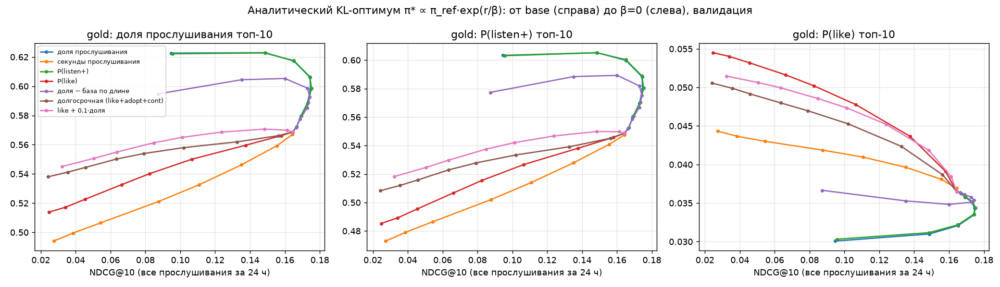
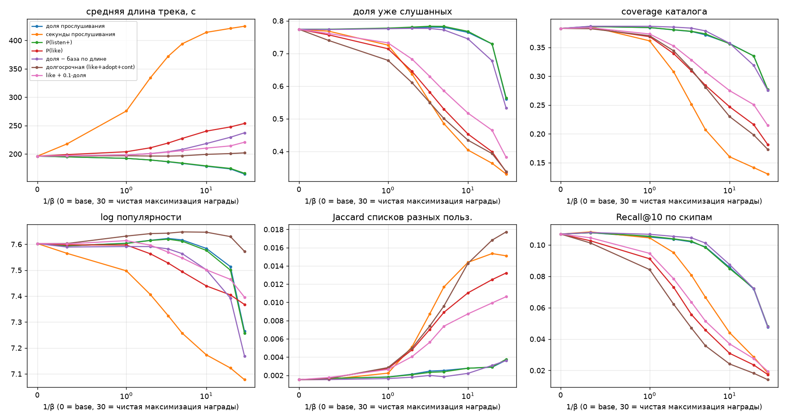
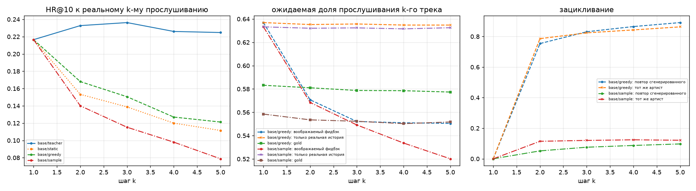

# RL-дообучение последовательного рекомендателя по модели награды: что получается и что ломается

Исследование на Yambda-50M (Яндекс Музыка). Базовая модель — GPT-2, предсказывающая следующий трек.
Модель награды предсказывает, как пользователь отреагирует на рекомендованный трек. Затем политика дообучается
с KL-регуляризацией (GRPO-подобный policy gradient). Вся оценка идёт по одному протоколу: глобальное разбиение по
времени, метрики релевантности на реальных будущих прослушиваниях и независимый «gold»-судья для наград.

## Коротко

**Главный вывод в трёх частях.**
1. Награду можно поднять без потери релевантности, и даже с выигрышем на реальных данных. Но **RL-дообучение
   самой GPT-2 этого не даёт**: при любых настройках политика значимо теряет точность. Причина — выразимость.
   Награда меняется от трека к треку из-за признаков «пользователь × трек» (сколько раз слушал, как дослушивал),
   а выход GPT-2 «контекст × эмбеддинг трека» их почти не выражает.
2. **Если дать политике эти признаки** (замороженная GPT-2 + маленькая голова над топ-1000 кандидатов), тот же
   GRPO начинает работать. При β=0,3 на тесте значимо растут next-item HR@10 (+0,004), Recall@10 по дослушанным
   трекам следующих суток (+0,014) и gold-награда (+0,016), а открытия новых треков не страдают. Proxy и
   независимый судья при этом растут одинаково, то есть голова не эксплуатирует ошибки модели награды.
3. **Но офлайн-метрики «по реальному будущему» легко выиграть повторами.** Двухпараметрическая эвристика
   «добавь бонус за число прослушиваний трека» даёт самый большой прирост Recall (+0,032) и даже HR@10, ценой
   −62 % по открытиям новых треков. Если считать только треки, которые пришли через рекомендации сервиса и были
   дослушаны, эвристика вдвое **хуже** базы (−54 %). π* при β=0,3 здесь даёт +7 % (по новым трекам +11 %),
   cross-политика +3 %. Полезная часть модели награды — **избирательность** (дослушают или пролистают) и
   **сохранение открытий**, а не сам рост Recall.

Подробнее:

1. **Точный KL-оптимум как ориентир.** π* ∝ π_ref·exp(r/β) — реранкинг топ-1000 базовой модели по
   `log π_ref + r/β`.
   - На тесте при β=1 значимо растут HR@10, Recall@10 по дослушанным и по открытиям.
   - При β=0,3 HR@10 не меняется, Recall по дослушанным +10 %, gold +0,029.
   - Дальше компромисс жёсткий: при β=0,1 HR@10 −17 % на тесте, при аргмаксе RM — втрое ниже.
2. **Что «взламывается» — зависит от награды.**
   - «Доля прослушивания» укорачивает треки (196 → 165 с; это ~20 % её gold-выигрыша).
   - «Секунды» удлиняют их: без ограничения кандидатов почти всем достаётся один ~30-минутный трек; GRPO находит
     35-минутный трек даже с KL.
   - Лайк-награды схлопывают выдачу на нескольких хитах: один трек в 13–22 % списков.
   - Сильная оптимизация «доли» с персональными признаками уходит в повторы: 97 % знакомых треков в выдаче.
   - Proxy завышает выигрыш примерно вдвое, gold после β≈0,05 перестаёт расти.
3. **Структура сигнала.** RM хорошо предсказывает реакцию на залогированных показах: AUC listen+ 0,905. Но 96 %
   дисперсии её предсказаний — контекст, и только ~4 % — выбор трека. Внутри контекста proxy и gold согласованы
   лишь на ρ≈0,45, две RM одной архитектуры — на ρ≈0,6.
4. **Почему GPT-2 с RL не достигает оптимума.**
   - Без KL GRPO за 250 шагов схлопывается в один трек для всех.
   - С KL изменение логитов коррелирует с наградой лишь на 0,2–0,45, а KL тратится на побочные глобальные сдвиги.
   - Не помогают больше сэмплов, точный градиент, заморозка эмбеддингов и даже дистилляция π* «с учителем».
   - Поправку награды линейно через эмбеддинги треков можно выразить на 12 %, собственные лог-вероятности модели —
     на 60 %; признаки «пользователь × трек» объясняют 30 %.
   - С этими признаками RL работает (см. выше): объяснение проверено экспериментом, а не только корреляцией.
5. **Ограничение поддержки** — менять порядок только внутри топ-1000 базовой модели. Это главный практический
   регуляризатор против взлома через хвост каталога.
6. **Без модели награды.** Positive-CE безопасен, но слаб. DPO на парах из логов сжимает выдачу: один трек в 25 %
   списков, HR@10 −59 %. Пессимизм ансамбля RM почти не помогает: ошибки моделей коррелированы.
7. **Многошаговая генерация.**
   - Жадная генерация зацикливается: 75 % повторов уже на 2-м шаге при 2,7 % в данных.
   - Оценка награды k-го трека зависит от непроверяемого допущения о реакции на прошлые рекомендации
     (0,635 / 0,55 / 0,28).
8. **Долгосрочные цели.**
   - Из сигналов годится «принятие» нового трека (AUC 0,75).
   - Продолжение сессии к треку не атрибутируется.
   - Офлайн это проверяется только частично; причинный эффект — только онлайн.
9. **Устойчивость.**
   - 11 автотестов на утечку проходят.
   - Разброс между сидами RL в 9–15 раз меньше эффектов по HR@10 и в 40–60 раз — по gold.
   - Выводы не меняются и в консервативном протоколе, где история строго раньше по времени. Это важно: у 19 %
     соседних прослушиваний одна и та же 5-секундная метка, и истинный порядок внутри такой группы неизвестен.

## Содержание
1. Постановка и вопросы
2. Данные и протокол
3. Модели и методы
4. Reward model: качество и где ей можно верить
5. Результаты: 5.1 базовая модель; 5.2 аналитический оптимум и компромисс; 5.3 поведение и функция награды;
   5.4 RL-обучение политики, 5.4.1 политика с признаками «пользователь × трек»; 5.5 методы без RM;
   5.6 долгосрочные цели; 5.7 многошаговая генерация; 5.8 тест; 5.9 устойчивость (сиды, утечки, порядок
   событий); 5.10 контроль: повторы против открытий
6. Гипотезы: подтверждены или нет
7. Ограничения
8. Что дальше
9. Воспроизведение

## 1. Постановка и вопросы

Next-item модель обучена имитировать логи: она рекомендует то, с чем пользователь, вероятнее всего,
провзаимодействует, а не то, что ему понравится. Идея из LLM-мира: взять модель награды (reward model, RM) и
дообучить генератор с RL так, чтобы растить ожидаемую награду, а KL-штраф к исходной модели не давал уйти далеко
от данных. Мы проверяем, переносится ли это в рекомендации и что при этом происходит с поведением.

Вопросы задания и где на них ответ:

| вопрос | раздел |
|---|---|
| Удаётся ли максимизировать награду, чем отличаются рекомендации, почему | 5.2–5.4.1 |
| Сохраняется ли релевантность, нет ли одинаковых рекомендаций всем | 5.2, 5.3, 5.8, 5.10 |
| Как сформулировать долгосрочную награду, что проверить офлайн и что только онлайн | 5.6 |
| Что происходит при генерации нескольких шагов вперёд | 5.7 |
| Компромисс релевантность ↔ награда, влияние функции награды и настроек RL | 5.2–5.4.1, 5.10 |

Ключевое методическое решение: **три независимых источника истины**, потому что награда, которую оптимизируют,
сама является моделью:
1. proxy RM — то, что видит и оптимизирует политика;
2. gold-судья — другая модель (другой алгоритм, признаки и длина истории), которую политика не видит (методология
   Gao et al., 2022);
3. реальные логи — что пользователь на самом деле дослушал, пропустил или лайкнул в следующие 24 часа.

Если растёт только (1), это взлом награды. Если (1) и (2) — возможно, улучшение, но обе модели могут ошибаться
одинаково. Если растёт (3) — это улучшение на реальных данных, пусть и в рамках логов старой политики.

## 2. Данные и протокол

**Датасет.** Yambda-50M (Яндекс Музыка): 9 238 пользователей, 46,5 млн прослушиваний за 301 день, 877 тыс. треков,
881 тыс. лайков. У каждого прослушивания есть доля прослушивания (`played_ratio_pct`, шаг 1 %), длина трека, флаг
`is_organic` (пользователь сам выбрал трек, а не сервис его подставил; 51,7 % прослушиваний органические). Время
округлено до 5 секунд и, как мы проверили в прошлой работе на тех же файлах, отмечает **конец** прослушивания.

Наблюдения, которые определяют постановку (весь датасет):

| факт | значение | следствие |
|---|---|---|
| доля прослушивания бимодальна | медиана 100 %, 25-й перцентиль 7 % | «досмотр» ≈ бинарный исход: скип или полное прослушивание |
| короткие треки дослушивают чаще | < 1 мин: 73 %; 4–5 мин: 62 %; > 8 мин: 53 % | награда «доля прослушивания» тянет к коротким трекам |
| повторы | 71 % прослушиваний — трек, который пользователь уже слушал | «рекомендовать знакомое» — легитимное и сильное поведение |
| органика vs рекомендации | доля прослушивания 60 % у органики, 70 % у рекомендаций | органику нельзя «заслужить» рекомендацией: в награду не идёт |
| длинный хвост | топ-50k треков = 80 % прослушиваний | словарь модели = 50k, остальное — UNK |

**Разбиение по времени (global temporal split).** Последние 7 дней — тест, 7 дней до них — валидация, всё раньше —
обучение (286 дней). Разбиение глобальное, не по пользователям: модель обучается только на событиях до начала
валидации. Словарь (50k треков) и все статистики треков считаются только по train. На валидации/тесте история
пользователя до момента рекомендации (в том числе события теста, произошедшие раньше) используется как контекст —
это прошлое, утечки нет. Метки, которые смотрят в будущее (лайк в течение часа, продолжение сессии, «принятие» за
3 дня), маскируются, если их горизонт пересекает границу своего сплита: обучающая метка никогда не заглядывает в
период валидации/теста. Лайки не используются как признак истории (лайк ранее прослушанного трека мог случиться уже
после момента решения).

| сплит | прослушиваний | пользователей | доля UNK | доля рекомендательных |
|---|---|---|---|---|
| train | 43,49 млн | 9 238 | 19,5 % | 48,3 % |
| val (7 дн) | 1,50 млн | 8 194 | 24,3 % | 48,3 % |
| test (7 дн) | 1,48 млн | 8 026 | 26,0 % | 49,4 % |

**Точки оценки.** Случайные прослушивания внутри сплита (трек из словаря, ≥ 20 событий истории), до 3 на
пользователя в тесте (22 890 точек) и 1 — на валидации (7 971). Для каждой точки модель видит последние 200
прослушиваний до неё и выдаёт топ-10.

**Метрики релевантности** (одинаковые для всех моделей):
- next item: HR@10 (= Recall@10 для одного таргета), NDCG@10, HR@100;
- множество треков, которые пользователь прослушал за следующие 24 часа (в пределах сплита): Recall@10 (нормирован
  на min(10, |S|)), NDCG@10, MAP@10 — отдельно по всем прослушиваниям, по listen+ (≥ 50 %), по скипам (< 10 %), по
  лайкнутым и по «принятым» трекам (см. ниже). Рост Recall по listen+ при падении Recall по скипам — прямое,
  не модельное свидетельство, что модель сдвинулась к трекам, которые пользователи реально дослушивают.

**Beyond-accuracy:** coverage каталога, индекс Джини по показам, доля самого частого трека, средний Jaccard
топ-10 у случайных пар пользователей (одинаковость выдачи), доля уже слушанных треков (repeat share), средняя длина
трека, средняя log-популярность, число артистов в списке, энтропия политики и точный KL(π‖π_ref).

## 3. Модели и методы

### 3.1 Базовая модель: GPT-2 next-item
`transformers.GPT2Model`, 4 слоя, d=256, 4 головы, контекст 200, выходной слой связан с эмбеддингами треков
(словарь 50 002: PAD, UNK, 50k треков). Токены — только id треков (вход политики не содержит фидбэка, поэтому её
можно разворачивать на несколько шагов вперёд без выдуманных реакций). Обучение — next-item cross-entropy по всем
прослушиваниям train (органика и рекомендации), UNK-таргеты игнорируются; 30k шагов × 64 окна × последние 64
позиции окна (≈ 2,8 эпохи по таргетам), AdamW, lr 1e-3, косинус. UNK никогда не рекомендуется.

### 3.2 Reward model (proxy)
Предсказывает отклик пользователя на **рекомендованный** трек. Обучается только на неорганических прослушиваниях
(действие сервиса); органика остаётся в истории как состояние — как в 2607.02818.
- История: 200 прошлых событий, эмбеддинг = трек + корзина доли прослушивания (0..10) + флаг органики,
  каузальный GPT-2 энкодер (2 слоя, d=128).
- Кандидат: собственный эмбеддинг трека, эмбеддинг артиста, log длины, log популярности.
- Признаки «история × кандидат» (считаются для любого кандидата, в том числе для всех 50k сразу): сколько раз трек был
  в истории, средняя доля его прослушивания, давность последнего прослушивания, то же для артиста, тот же ли артист,
  что у предыдущего трека, доля артиста в истории.
- MLP над [h, e, h⊙e, артист, признаки] → 5 голов: played (мягкая BCE по доле), full (≥ 50 %), like (за час),
  cont (следующее прослушивание начнётся в течение 30 минут — сессия продолжается), adopt (только для первого
  прослушивания трека, подставленного сервисом: пользователь в течение 3 дней сам вернётся к нему, дослушает ≥ 50 %,
  или лайкнет).
- 20k шагов, окно 201 событие, потери по позициям 100..199 (префикс ≥ 100 событий, как на инференсе).
- Ансамбль: ещё две модели с другими сидами и бутстрепом 80 % пользователей (для пессимистичной награды).

### 3.3 Gold-судья (независимый оценщик)
По методологии Gao et al. (2022) политика оптимизирует proxy RM, а оценивается независимым «gold»-судьёй, которого
она не видит. Судья намеренно устроен иначе: LightGBM вместо нейросети, история в 1 000 событий вместо 200,
target-encoding статистики трека и артиста (посчитаны на train до T−30 дней, а обучающие примеры судьи взяты из
последних 30 дней train — без утечки собственной метки), давность в секундах, пользовательские агрегаты. Gold — тоже
модель и тоже ошибается на непоказанных треках, поэтому третьим источником истины служат реальные логи (Recall по
listen+/скипам/лайкам).

### 3.4 Награды
Все награды нормируются (r − μ)/σ, где μ, σ измерены на треках, сэмплированных из π_ref, — тогда β одинаково
работает для всех наград и совпадает с β аналитического оптимума.

| имя | формула | что проверяем |
|---|---|---|
| played | E[доля прослушивания] | награда «из задания»; ожидаем сдвиг к коротким трекам |
| seconds | E[доля] · длина | обратный перекос: к длинным трекам |
| full | P(≥ 50 %) | listen+ из Yambda |
| played_db | E[доля] − E[доля \| дециль длины] | снятие duration bias (идея D2Q) |
| like | P(like) | редкий явный сигнал удовлетворённости |
| paper2 | P(like) + 0,1·E[доля] | награда из 2607.02818 |
| lt | (z_like + z_adopt·[трек новый] + z_cont) / 3 | прокси долгосрочной ценности: открытие треков, которые пользователь потом слушает сам, и продолжение сессии |

### 3.5 Методы дообучения
1. **Аналитический KL-оптимум (без обучения).** Цель KL-регуляризованного RL E_π[r] − β·KL(π‖π_ref) имеет
   решение π* ∝ π_ref·exp(r/β). Для одного шага рекомендации пространство действий перечислимо (50k), поэтому π*
   можно посчитать точно: ранжировать кандидатов по log π_ref + r/β. Кандидаты — топ-1000 π_ref (масса вне них
   сохраняется с нейтральной наградой при подсчёте KL); отдельно — все 50k на 1 000 контекстах. β = ∞ — исходная
   модель, β = 0 — жадная максимизация RM.
2. **GRPO-подобный policy gradient.** На каждый контекст (неорганическое прослушивание из train) из текущей политики
   сэмплируется G=16 треков, RM их оценивает, advantage = r − среднее по группе, лосс = −A·log π + β·KL, где KL
   считается **точно** по всему словарю (не k3-оценкой, как в LLM). On-policy, один шаг на батч, поэтому клиппинг
   отношения не нужен. 1 500 шагов × 64 контекста, lr 1e-4. Каждые 250 шагов — точка кривой на 2 000 контекстах
   валидации: proxy, gold, HR@10, KL, энтропия.
3. **Многошаговый GRPO.** Политика генерирует последовательность из T=5 треков, каждый добавляется в её контекст;
   награда последовательности — сумма наград шагов (повтор уже сгенерированного трека — штраф −1), опционально бонус
   за число разных артистов. Две версии RM-контекста: *real* — каждый трек оценивается по реальной истории;
   *imagined* — сгенерированные треки входят в историю RM с «воображаемой» долей прослушивания, которую RM сама же
   предсказала.
4. **Без reward model:** Positive-CE (дообучение next-item только на прослушиваниях ≥ 50 %, бейзлайн из 2607.02818) и
   DPO на парах из логов (отвергнутый — скипнутая рекомендация, выбранный — ближайшая следующая рекомендация того же
   пользователя, прослушанная ≥ 80 %).

## 4. Reward model: качество и где ей можно верить

### 4.1 Качество на отложенной выборке (тест, 60 000 рекомендательных прослушиваний)

| голова | метрика | proxy RM (нейросеть) | ансамбль: rm1 / rm2 | gold (LightGBM) | константа |
|---|---|---|---|---|---|
| доля прослушивания | MAE | **0,191** | 0,192 / 0,192 | 0,212 | 0,380 |
| доля прослушивания | Pearson | **0,728** | 0,726 / 0,726 | 0,689 | — |
| listen+ (≥ 50 %) | AUC | **0,905** | 0,905 / 0,904 | 0,888 | 0,5 |
| listen+ | AUC внутри пользователя (GAUC) | **0,761** | — | 0,722 | 0,5 |
| лайк в течение часа (1,8 %) | AUC | **0,810** | 0,792 / 0,783 | 0,796 | 0,5 |
| сессия продолжается (95,5 %) | AUC | 0,623 | 0,619 / 0,622 | 0,621 | 0,5 |
| «принятие» нового трека (3,2 %) | AUC | **0,753** | — | 0,738 | 0,5 |

Калибровка средних точная во всех головах (например, P(like): предсказано 1,70 %, факт 1,78 %). По срезам (длина
трека, первый раз / повтор, популярность) AUC listen+ у proxy 0,90–0,915, смещение средней доли прослушивания
не больше 0,011 по модулю; единственный заметный перекос — новые для пользователя треки: proxy завышает долю
прослушивания на +0,011 (повторы занижает на −0,007). Это ровно то направление, в котором RL будет искать «дешёвую»
награду.

Две головы почти бесполезны для управления выдачей: **продолжение сессии** (AUC 0,62 — завершение сессии
определяется временем суток и состоянием пользователя, а не треком) и, в меньшей степени, **принятие** (AUC 0,75,
но базовая частота 3 % и сильная зависимость от пользователя). Это первое ограничение для «долгосрочных» наград:
из логов плохо выделяется вклад конкретного трека.

### 4.2 Почему высокое качество RM ещё не значит, что её можно оптимизировать

На залогированных парах (то, что сервис реально показал) proxy и gold согласованы почти идеально: Spearman 0,93.
Но политике нужно сравнивать **разные треки в одном и том же контексте**. Мы взяли 300 контекстов валидации и
1 000 кандидатов базовой модели в каждом и оценили всех кандидатов обеими моделями:

| что сравниваем | Spearman proxy–gold | Spearman rm0–rm1 (та же архитектура, другой сид и бутстреп) |
|---|---|---|
| один и тот же кандидат (ранг 1) в разных контекстах | 0,84 | 0,97 |
| разные кандидаты внутри одного контекста, ранги 1–10 | 0,43 | 0,62 |
| то же, ранги 301–1000 | 0,47 | 0,54 |

96 % дисперсии предсказанной доли прослушивания приходится на различия между контекстами («насколько этот
пользователь сейчас вообще дослушивает треки»), и только ~4 % — на выбор трека. Именно эти 4 % и может менять
рекомендатель, и именно в них модели наград расходятся: две RM одной архитектуры, обученные на почти одинаковых
данных, ранжируют кандидатов внутри контекста с корреляцией лишь 0,6 (underspecification, ср. Eisenstein et al.).

Цена оптимизации по proxy («проклятие оптимизатора»): если в каждом контексте взять кандидата с максимальной
proxy-оценкой доли прослушивания, proxy обещает 0,800, gold даёт 0,681 (у кандидата ранга 1 базовой модели proxy даёт 0,643, gold — 0,593;
лучший кандидат по самому gold — 0,753). То есть оптимизация proxy реально улучшает исход по независимому судье
(+0,09), но proxy систематически переоценивает выигрыш в ~1,8 раза (+0,157 против +0,088). Аргмакс proxy уходит в середину списка
кандидатов (медианный ранг 238 из 1 000) — туда, где данных о показах меньше.

## 5. Результаты

Все числа в разделах 5.1–5.7 посчитаны на **валидации** (7 971 контекст, по одному на пользователя): на ней
выбирались β и настройки. Финальная проверка на **тесте** с бутстреп-интервалами — в разделе 5.8. Награды топ-10
усреднены по 10 позициям; «gold played» — ожидаемая доля прослушивания по gold-судье.

### 5.1 Базовая модель и простые ориентиры

| модель | HR@10 next | NDCG@10 next | Recall@10 (24 ч, все) | NDCG@10 (24 ч, все) | Recall@10 listen+ | Recall@10 скипы | gold played | coverage | доля повторов |
|---|---|---|---|---|---|---|---|---|---|
| самые популярные | 0,013 | — | 0,025 | 0,025 | 0,020 | — | 0,542 | 0,0002 | 0,51 |
| «самые частые треки пользователя» | 0,142 | — | **0,195** | **0,189** | **0,177** | 0,139 | 0,580 | 0,52 | 1,00 |
| **GPT-2 base** | **0,207** | 0,136 | 0,168 | 0,164 | 0,149 | 0,107 | 0,569 | 0,38 | 0,77 |

- GPT-2 хорошо решает свою задачу: следующий трек попадает в топ-10 в 21 % случаев против 14 % у эвристики. Энтропия
  его распределения — 7 нат, то есть примерно 1 300 «эффективных» кандидатов.
- По множеству треков следующих суток простая эвристика «самые частые треки пользователя» лучше: 71 % прослушиваний
  в Yambda — повторы, и за сутки пользователь переслушивает любимое.
- Next-item модель оптимизирует ближайший шаг, а не сутки. Это важно для интерпретации раздела 5.2: часть
  «выигрыша по реальным данным» от RM — сдвиг именно к тем трекам, которые пользователь дослушает и переслушает.
- Числа не сравнимы напрямую с таблицами статьи Yambda: у нас другой протокол (точки внутри 7-дневного теста,
  словарь 50k, сутки после точки).

### 5.2 Аналитический KL-оптимум: сколько награды можно получить и чем за неё платим

Это ответ на вопросы 1, 2 и 5 «в идеальном случае»: π* — точное решение той же задачи, которую решает
KL-регуляризованный RL. Бо́льшего при данном β обученная политика получить не может, она может только
приблизиться (см. 5.4).



*Каждая кривая — одна функция награды, точки — β от ∞ (база, справа) до 0 (слева). По оси X — NDCG@10 на реальных
прослушиваниях следующих суток, по Y — gold-судья.*

Награда «доля прослушивания» (`played`); для `full` = P(listen+) результаты почти совпадают:

| β | KL(π‖π_ref) | HR@10 next | NDCG@10 (24 ч) | Recall@10 listen+ | Recall@10 скипы | Recall@10 лайки | proxy played | **gold played** | длина, с |
|---|---|---|---|---|---|---|---|---|---|
| ∞ (база) | 0 | 0,207 | 0,164 | 0,149 | 0,107 | 0,051 | 0,627 | 0,569 | 196 |
| 3 | 0,008 | 0,209 | 0,167 | 0,152 | 0,108 | 0,048 | 0,634 | 0,572 | 195 |
| 1 | 0,07 | 0,207 | 0,169 | 0,157 | 0,105 | 0,047 | 0,646 | 0,580 | 192 |
| 0,5 | 0,22 | 0,206 | 0,173 | 0,161 | 0,104 | 0,047 | 0,662 | 0,589 | 189 |
| **0,3** | 0,42 | 0,202 | **0,175** | **0,164** | 0,102 | 0,044 | 0,678 | 0,598 | 186 |
| 0,2 | 0,61 | 0,194 | 0,174 | 0,166 | 0,099 | 0,040 | 0,693 | 0,606 | 183 |
| 0,1 | 1,00 | 0,170 | 0,165 | 0,160 | 0,086 | 0,034 | 0,715 | 0,617 | 178 |
| 0,05 | 1,72 | 0,134 | 0,149 | 0,145 | 0,072 | 0,026 | 0,729 | **0,623** | 174 |
| 0 (аргмакс RM) | — | 0,065 | 0,095 | 0,091 | 0,048 | 0,014 | 0,739 | 0,623 | 165 |

Что видно:
1. **Награду максимизировать удаётся**, и это не только иллюзия proxy: gold растёт с 0,569 до 0,623.
   - Проксимальная оценка завышает выигрыш вдвое: +0,11 против +0,054 у gold.
   - После β≈0,05 gold перестаёт расти, хотя proxy продолжает. Это классическая картина переоптимизации
     (Gao et al.): дальнейшее «улучшение» видит только оптимизируемая модель.
2. **Есть участок без потерь.** До β≈0,3 next-item HR@10 почти не меняется. Метрики по реальным суткам при этом
   растут: NDCG@10 +0,011, Recall@10 по дослушанным трекам +0,015 (+10 %), MAP@10 по ним +0,012. Recall по скипам
   падает (0,107 → 0,102).
   - Модель предпочитает те треки из «правдоподобных», которые пользователь в реальности дослушивает, и отодвигает
     те, которые он пропускает. Это подтверждение на реальных исходах, а не на модели.
   - Дальше компромисс жёсткий: при β=0,1 HR@10 −18 %, при аргмаксе — втрое ниже.
3. **Recall по лайкам падает** с самого начала (0,051 → 0,044 при β=0,3): оптимизация доли прослушивания не равна
   оптимизации удовольствия. Дослушанное — часто «фоновое» и короткое (раздел 5.3).
4. Выбор β по валидации: β≈0,3 (лучший NDCG по суткам при HR −2,5 %) или β≈0,1, если важнее награда. На тесте
   проверены оба (раздел 5.8).

**Ограничение кандидатов.** Эти результаты — для переранжирования топ-1000 базовой модели. На 1 000 контекстов мы
посчитали и неограниченный оптимум по всем 50k трекам:

| награда, β | топ-1000: gold played / HR@10 / top-1 доля / длина | все 50k: gold played / HR@10 / top-1 доля / длина |
|---|---|---|
| played, 0,3 | 0,594 / 0,215 / 0,11 / 185 с | 0,594 / 0,216 / 0,11 / 185 с |
| played, 0,1 | 0,614 / 0,182 / 0,11 / 176 с | 0,617 / 0,177 / 0,10 / 176 с |
| played, 0 | 0,620 / 0,065 / 0,08 / 163 с | 0,630 / 0,043 / **0,35** / 141 с |
| seconds, 0,3 | 0,526 / 0,138 / 0,14 / 372 с | 0,432 / 0,025 / **0,93** / **1 598 с** |
| seconds, 0 | 0,489 / 0,015 / 0,17 / 425 с | 0,420 / 0,000 / **0,99** / **1 727 с** |

При разумном β и «хорошей» награде KL-штраф сам держит π* внутри поддержки, и ограничение ничего не меняет. При
β → 0 или при награде с тяжёлым хвостом (секунды не ограничены сверху) оптимум уходит в хвост каталога. Там данных о
показах мало, RM экстраполирует, и выдача схлопывается в один трек для всех. Двухстадийная схема «кандидаты базовой
модели → переранжирование по награде» — простой и сильный регуляризатор.

**Пессимизм ансамбля.** Награда «среднее − k·std» по трём RM (`rm0` и две модели с бутстрепом пользователей).
- При k=1 фронт «HR@10 – gold» немного лучше. При β=0,1: HR 0,180 против 0,170 при том же gold 0,616–0,617; это
  примерно +0,004 gold при равном HR.
- При k=3 хуже по обоим осям.

Разброс ансамбля мал (std доли ≈ 0,023) и слабо связан с ошибкой относительно gold. Три RM одной архитектуры на почти
одних данных ошибаются одинаково, что согласуется с Eisenstein et al. (2023).

### 5.3 Как функция награды меняет поведение



| награда (β=0 / β=0,3) | длина трека, с | доля повторов | coverage | top-1 доля | Jaccard пар | gold played | gold P(like) | HR@10 |
|---|---|---|---|---|---|---|---|---|
| база | 196 | 0,77 | 0,38 | 0,06 | 0,0015 | 0,569 | 0,036 | 0,207 |
| played | 165 / 186 | 0,56 / 0,78 | 0,28 / 0,38 | 0,07 / 0,09 | 0,004 / 0,003 | 0,623 / 0,598 | 0,030 / 0,034 | 0,065 / 0,202 |
| played − база по длине | 237 / 204 | 0,53 / 0,78 | 0,28 / 0,38 | — | 0,004 / 0,002 | 0,595 / 0,593 | — | 0,062 / 0,203 |
| seconds | 425 / 372 | 0,33 / 0,55 | 0,13 / 0,25 | 0,17 / 0,15 | 0,015 / 0,009 | 0,494 / 0,533 | 0,044 / 0,041 | 0,014 / 0,149 |
| like | 254 / 219 | 0,34 / 0,58 | 0,18 / 0,31 | 0,13 / 0,13 | 0,013 / 0,007 | 0,514 / 0,540 | **0,055** / 0,050 | 0,020 / 0,103 |
| like + 0,1·доля (2607.02818) | 221 / 203 | 0,38 / 0,63 | 0,21 / 0,33 | 0,14 / 0,10 | 0,011 / 0,006 | 0,545 / 0,565 | 0,052 / 0,047 | 0,024 / 0,123 |
| lt: like + принятие + сессия | 202 / 196 | 0,34 / 0,55 | 0,17 / 0,31 | **0,22** / 0,14 | **0,018** / 0,007 | 0,538 / 0,554 | 0,051 / 0,047 | 0,014 / 0,088 |

Объяснения:
- **Длина трека — главный «дешёвый» рычаг.** Короткие треки дослушивают чаще: < 1 мин — 73 %, > 8 мин — 53 %.
  Награда «доля» тянет к коротким трекам, награда «секунды» — к длинным, причём сильнее: секунды не ограничены
  сверху. Вычитание средней доли для дециля длины (идея D2Q) убирает сдвиг к коротким при умеренном β (204 с против
  186 с), но при β→0 перекорректирует в длинные (237 с). Это нормировка «в среднем», а не причинная поправка.
  Gold played у дебиасной версии почти тот же (0,593 против 0,598 при β=0,3). Значит, заметная доля выигрыша у
  «доли» действительно идёт от длины.
- **Повторы.** При умеренном β доля уже слушанных треков даже растёт (0,774 → 0,781): RM знает, что любимое
  дослушивают. При β→0 она падает до 0,56: аргмакс RM уходит в новые треки, которые RM переоценивает — для первых
  прослушиваний RM завышает долю на +0,011, см. 4.1.
- **Лайк-награды схлопывают выдачу.** P(like) у большинства треков около 1–3 %, но у нескольких «хитов» в
  разы выше. После нормировки лайк-компонента получает тяжёлый правый хвост. Поэтому уже при β=1 KL в 5 раз больше,
  чем у доли, а при β=0 один и тот же трек оказывается в 13–22 % всех списков: Jaccard между списками разных
  пользователей растёт в 10 раз. Это ответ на вопрос «не начинает ли модель рекомендовать всем одно и то же»:
  да, начинает — для лайк-наград сразу, для доли прослушивания только при β→0.
- **Gold P(like) растёт** (0,036 → 0,055), а **реальный Recall@10 по лайкам падает** (0,051 → 0,024). Модели
  научились предсказывать «лайкабельные вообще» треки, но в реальности пользователь лайкает свои, а не чужие хиты.
  Здесь gold и proxy ошибаются одинаково: обе модели используют популярность и лайк-рейт трека. Только реальные
  логи показывают, что это не улучшение. При мягком β=3 Recall по лайкам немного растёт (0,051 → 0,054).

### 5.4 RL-обучение политики (GRPO): что получается на самом деле

Алгоритм описан в 3.5: 16 сэмплов на контекст, advantage = r − среднее по группе, точный KL ко всему
распределению π_ref. Базовые настройки: 1 500 шагов × 64 контекста, lr 1e-4. Кривые обучения (точки каждые 250
шагов на 2 000 контекстах валидации) лежат в `results/rl_*.json`.


*Чёрная линия — аналитический оптимум π* при разных β; маркеры — обученные политики. Слева: gold-награда против KL;
в центре: HR@10 против KL; справа: фронт «HR@10 – gold».*

**Основные прогоны** (валидация; база: HR@10 0,207, NDCG@10 по суткам 0,164, Recall@10 listen+ 0,149,
gold played 0,569):

| политика | KL | энтропия | HR@10 | NDCG@10 (24 ч) | Recall@10 listen+ | proxy played | gold played | длина, с | coverage | top-1 доля |
|---|---|---|---|---|---|---|---|---|---|---|
| GRPO played, β=1 | 0,05 | 6,92 | 0,203 | 0,162 | 0,148 | 0,631 | 0,571 | 192 | 0,37 | 0,07 |
| GRPO played, β=0,3 | 0,08 | 6,83 | 0,201 | 0,162 | 0,148 | 0,639 | 0,575 | 187 | 0,36 | 0,09 |
| GRPO played, β=0,1 | 0,27 | 6,52 | 0,190 | 0,156 | 0,142 | 0,652 | 0,581 | 179 | 0,32 | 0,15 |
| GRPO played, β=0 (без KL) | 12,1 | **0,006** | **0,008** | 0,008 | 0,010 | 0,674 | 0,608 | 127 | **0,007** | **1,00** |
| *π*, β=1 (для сравнения)* | *0,07* | — | *0,207* | *0,169* | *0,157* | *0,646* | *0,580* | *192* | *0,38* | *0,07* |
| *π*, β=0,5* | *0,22* | — | *0,206* | *0,173* | *0,161* | *0,662* | *0,589* | *189* | *0,38* | *0,08* |
| GRPO seconds, β=0,3 | 12,4 | 0,04 | 0,017 | 0,007 | 0,010 | 0,548 | 0,472 | **832** | 0,015 | **1,00** |
| GRPO seconds, β=0,3, топ-1000 | 2,75 | 3,84 | 0,139 | 0,099 | 0,092 | 0,588 | 0,510 | 362 | 0,20 | 0,22 |
| GRPO played, β=0, топ-1000 | 6,2 | 0,91 | 0,054 | 0,060 | 0,059 | 0,674 | 0,589 | 148 | 0,08 | 0,28 |
| GRPO full, β=0,3 | 0,08 | 6,81 | 0,200 | 0,162 | 0,147 | 0,639 | 0,575 | 187 | 0,36 | 0,09 |
| GRPO played_db, β=0,3 | 0,08 | 6,89 | 0,202 | 0,160 | 0,145 | 0,633 | 0,569 | 205 | 0,36 | 0,07 |
| GRPO like, β=0,3 | 0,37 | 6,48 | 0,190 | 0,149 | 0,134 | 0,613 | 0,553 | 212 | 0,32 | 0,11 |
| GRPO lt, β=0,3 | 0,18 | 7,19 | 0,186 | 0,151 | 0,137 | 0,620 | 0,562 | 198 | 0,33 | 0,10 |
| GRPO like+0,1·доля, β=0,3 | 0,18 | 6,64 | 0,196 | 0,157 | 0,142 | 0,627 | 0,564 | 201 | 0,34 | 0,09 |
| GRPO played, β=0,1, пессимизм k=1 | 0,23 | 6,56 | 0,187 | 0,155 | 0,141 | 0,649 | 0,581 | 178 | 0,32 | 0,13 |

**1. Максимизировать награду удаётся, но дорого.** Proxy и gold растут монотонно с уменьшением β, однако:
- Без KL (β=0) политика за 250 шагов схлопывается: для всех пользователей один и тот же 105-секундный трек
  (99,99 % списков), энтропия 7,06 → 0,006. Gold при этом даже выше (0,608), чем у любого разумного варианта.
  Судья хвалит «самый дослушиваемый трек вообще», но такой выдачей пользоваться нельзя: HR@10 0,008.
  Это главный ответ на вопрос «можно ли увеличить награду без потери точности» в варианте без регуляризации: нет.
- Награда без верхней границы (секунды) ломает политику **даже с KL**. GRPO сэмплирует из всего каталога, находит
  35-минутный трек (2 130 с, 511 прослушиваний в train) и отдаёт его всем. Аналитический оптимум по топ-1000
  этого не делал, потому что этот трек не попадает в кандидаты. Ограничение политики топ-1000 базовой модели
  («переранжирование внутри поддержки») снимает коллапс: длина 362 с вместо 832, HR@10 0,139 вместо 0,017.
  Награда при этом всё равно плохая.

**2. Обученная политика заметно хуже точного оптимума.** На фронте «KL – gold» и «HR – gold» все обученные политики
лежат ниже чёрной линии π*:
- GRPO β=0,3 при KL 0,08 даёт gold 0,575 и HR 0,201. π* при почти том же KL (β=1, KL 0,07) — gold 0,580 и HR 0,207.
- GRPO β=0,1 при KL 0,27 даёт gold 0,581 и HR 0,190. π* при KL 0,22 — gold 0,589 и HR 0,206.

Примерно вдвое меньше прироста gold на единицу KL (для точного градиента и DPO — в 4–6 раз). Хуже того, **на реальных данных** все RL-политики теряют
NDCG и Recall по суткам (например, Recall@10 listen+ 0,149 → 0,142–0,148). π* при том же KL их **повышает**
(0,157–0,161). То есть «бесплатный» участок из 5.2 RL-обучением не достигается.

**3. Почему так: диагностика.** Метрика — корреляция внутри контекста между изменением логитов политики
(log π − log π_ref) и нормированной наградой на топ-100 кандидатах. У π* она равна 1 по построению.

| вариант (β=0,3, если не указано) | что меняли | KL | gold played | корреляция с наградой: val / train-контексты | std изменения логитов |
|---|---|---|---|---|---|
| GRPO, lr 1e-4, 1 500 шагов | — | 0,08 | 0,575 | 0,35 / 0,32 | 0,38 |
| GRPO β=0,1 | слабее KL | 0,27 | 0,581 | 0,44 / 0,41 | 0,65 |
| GRPO, lr 5e-4, 6 000 шагов | больше шагов и lr | 0,28 | 0,576 | 0,28 / 0,26 | 0,78 |
| то же, G=64 | в 4 раза больше сэмплов | 0,26 | 0,576 | 0,29 / 0,28 | 0,74 |
| точный градиент по топ-1000 | **нет шума сэмплирования** | 0,47 | 0,575 | 0,22 / 0,20 | 0,86 |
| GRPO, эмбеддинги заморожены | выходной слой не двигается | 0,09 | 0,573 | 0,20 / 0,20 | 0,42 |
| Positive-CE | без RM | 0,08 | 0,572 | 0,09 | 0,39 |
| DPO β=1 | без RM | 0,19 | 0,576 | 0,14 | 0,60 |
| DPO β=0,1 | без RM | 1,62 | 0,578 | 0,15 | 1,62 |
| **дистилляция π***, lr 5e-4 | обучение с учителем на точный оптимум | 0,31 | 0,574 | 0,22 / — | 0,67 |
| **дистилляция π***, lr 1e-4 | то же, медленнее | 0,12 | 0,574 | 0,30 / — | 0,41 |

Выводы из таблицы:
- **Не шум сэмплирования.** Учетверение группы ничего не меняет, а точный градиент по 1 000 кандидатам без
  сэмплирования даже хуже: он тратит больше всего KL при той же награде.
- **Не переобучение.** На обучающих контекстах согласованность та же, что на валидации (0,32 против 0,35).
- **Не связанный выходной слой.** Заморозка эмбеддингов уменьшает дрейф, но и согласованность падает.
- Остаётся **сама постановка обучения**. Награда, которую надо «вшить» в политику, — это внутриконтекстная поправка
  с малой амплитудой (≈4 % дисперсии RM, см. 4.2). Она зависит от тонких признаков «пользователь × трек»:
  сколько раз слушал, как дослушивал, тот же ли артист. Policy gradient приносит слабый сигнал, а Adam
  нормирует шаги, поэтому каждый шаг двигает параметры на фиксированную величину. Сигнал усиливается вместе с шумом,
  и большая часть «потраченного» KL уходит в изменения, не связанные с наградой. Чем больше lr и шагов, тем больше
  KL и тем ниже согласованность.
- Политика «помнит» и глобальную часть: доля изменения, объяснимая константой на трек, 0,2–0,5, и выдача немного
  сжимается (top-1 доля растёт с 0,06 до 0,09–0,15).

**4. Может ли сеть вообще выразить π\*?** Самая прямая проверка — убрать RL совсем и учить политику с учителем:
кросс-энтропия к точному оптимуму π* = π_ref·exp(r/β)/Z для каждого обучающего контекста (`--pg distill`).
Результат тот же. При lr 5e-4 KL растёт до 0,31 (у целевого π* — 0,42), но gold почти не меняется (0,574), а
согласованность с наградой 0,22. При lr 1e-4 KL 0,12, gold 0,574 при HR@10 0,200 на валидации, согласованность 0,30. На тесте дистилляция,
как и GRPO, значимо теряет HR@10 (0,193 → 0,177–0,185). Узкое место — не сигнал RL, а то, что политика не может
представить нужную поправку.

**5. Выразимость (softmax bottleneck).** Выход GPT-2 — `logit(a|s) = ⟨h_s, e_a⟩`; эмбеддинги треков общие для
всех контекстов. Проверим, насколько поправку r(s,·), которую требует π*, можно записать как ⟨w_s, e_a⟩ + b_s при
неизменных e_a. Для 300 контекстов валидации подбирали w_s гребневой регрессией на случайной половине топ-1000
кандидатов и считали R² на другой половине (`src/bottleneck.py`):

| что приближаем через ⟨w_s, e_a⟩ | отложенный R² |
|---|---|
| собственные лог-вероятности базовой модели | **0,60** |
| нормированная награда RM (то, что нужно добавить для π*) | **0,12** |
| та же награда, перемешанная внутри контекста (уровень случайности) | ≤ 0 |

Распределение базовой модели «живёт» в пространстве эмбеддингов треков, а награда — почти нет. Награда
определяется признаками «пользователь × трек»: сколько раз слушал этот трек, как его дослушивал, как давно,
дослушивает ли этого артиста. Через один вектор контекста их не передать. Чтобы всё же сдвинуть
распределение в нужную сторону, обучение двигает эмбеддинги, общие для всех пользователей. Отсюда глобальные
побочные эффекты (выдача сжимается, top-1 доля растёт) и KL, потраченный не на награду. У аналитического π*
этой проблемы нет: он применяет поправку RM напрямую, а RM считает эти признаки явно. Вывод для практики:
если награда опирается на признаки, которых нет в представлении политики, её надо применять на этапе
ранжирования (реранкинг), а не пытаться «вшить» в генератор через RL. Альтернатива — дать политике такие
признаки. Это мы проверили экспериментом в 5.4.1: с ними тот же GRPO работает.


**6. Многошаговое GRPO** (5 треков подряд, награда за последовательность, раздел 3.5) по одношаговым метрикам
не отличается от одношагового при том же β: HR@10 0,194–0,196, gold 0,573–0,574, KL 0,08–0,09. Бонус за
разнообразие артистов немного увеличивает число артистов в списке (7,60 → 7,68) и снижает top-1 долю
(0,066 → 0,059). Как многошаговое обучение меняет поведение при генерации вперёд — в 5.7.

**7. Пессимизм в RL** (ансамбль из трёх RM, награда = среднее − std) при β=0,1 дал почти то же, что обычный GRPO:
gold 0,581 и 0,581, HR 0,187 и 0,190, KL 0,23 и 0,27. Разброс ансамбля слишком мал и не там, где ошибка.

#### 5.4.1 Своя идея: дать политике признаки «пользователь × трек»

Из пункта 5 следует проверяемое предсказание. Если RL-политике мешает именно выразимость, то политика, которая
*видит* признаки «пользователь × трек», должна заработать с тем же RL.

**Архитектура** (`src/policy.py`, `CrossHeadPolicy`; запуск `rl.py --policy cross`):
- GPT-2 заморожена, она даёт π_ref и топ-1000 кандидатов;
- поверх — маленькая голова (MLP 11 → 64 → 64 → 1, около 5 тыс. параметров). Для каждого кандидата она видит те
  же признаки истории, что и модель награды: сколько раз пользователь слушал трек, как дослушивал, давность, то
  же для артиста, тот же ли артист, что был только что, — плюс длину и популярность трека и log π_ref;
- голова добавляет поправку к логиту: `logit(a|s) = logit_ref(a|s) + head(...)`. Последний слой инициализирован
  нулём, поэтому обучение стартует ровно с π_ref;
- обучение — тот же GRPO с точным KL внутри топ-1000, 3 000 шагов, lr 1e-3; отдельно — дистилляция π* в эту
  голову.

Статическая проверка (как в п. 5): обученная на половине контекстов модель по признакам головы объясняет
**30 %** внутриконтекстной дисперсии награды на другой половине. Через эмбеддинги треков — 12 %. Главные признаки:
длина трека (43 % важности), как пользователь дослушивает этого артиста (20 %), популярность (12 %).

**Результаты** (валидация; KL измерен внутри топ-1000):

| политика | KL | HR@10 | NDCG@10 (24 ч) | Recall@10 listen+ | Recall@10 скипы | proxy played | gold played | доля повторов | top-1 доля |
|---|---|---|---|---|---|---|---|---|---|
| база | 0 | 0,207 | 0,164 | 0,149 | 0,107 | 0,627 | 0,569 | 0,77 | 0,06 |
| cross, GRPO β=1 | 0,004 | **0,209** | 0,169 | 0,154 | 0,108 | 0,633 | 0,574 | 0,77 | 0,06 |
| **cross, GRPO β=0,3** | 0,048 | **0,208** | 0,178 | 0,164 | 0,109 | 0,644 | 0,585 | 0,78 | 0,07 |
| cross, GRPO β=0,1 | 0,50 | 0,201 | **0,189** | **0,178** | 0,110 | 0,667 | 0,608 | 0,82 | 0,07 |
| cross, GRPO без KL | 5,96 | 0,117 | 0,150 | 0,151 | 0,084 | 0,695 | **0,637** | **0,97** | 0,05 |
| cross, дистилляция π*, β=0,3 | 0,075 | **0,210** | 0,183 | 0,170 | 0,113 | 0,649 | 0,590 | 0,80 | 0,07 |
| cross, GRPO на «секундах», β=0,3 | 3,17 | 0,142 | 0,096 | 0,091 | 0,076 | 0,572 | 0,499 | 0,51 | 0,27 |
| *для сравнения:* GRPO GPT-2, β=0,3 | 0,075 | 0,201 | 0,162 | 0,148 | 0,105 | 0,639 | 0,575 | 0,77 | 0,09 |
| *π*, β=0,3* | 0,42 | 0,202 | 0,175 | 0,164 | 0,102 | 0,678 | 0,598 | 0,78 | 0,09 |

Тест, разность с базой и 95 % ДИ (обычный протокол; в строгом — те же выводы, `bootstrap_vs_base_strict_cross.json`):

| политика | ΔHR@10 | ΔRecall@10 все (24 ч) | ΔRecall@10 listen+ | ΔRecall@10 скипы | ΔRecall@10 listen+ **новых** треков | Δgold played |
|---|---|---|---|---|---|---|
| cross, GRPO β=1 | **+0,0024** | **+0,0040** | **+0,0048** | +0,0005 | **+0,0010** | **+0,005** |
| **cross, GRPO β=0,3** | **+0,0040** [+0,0017; +0,0061] | **+0,0108** | **+0,0137** | **+0,0023** | +0,0010 [−0,0000; +0,0020] | **+0,016** |
| cross, GRPO β=0,1 | **−0,0040** | **+0,0204** | **+0,0274** | **+0,0052** | −0,0015 [−0,0030; +0,0002] | **+0,038** |
| cross, без KL | **−0,0768** | **−0,0106** | +0,0039 | **−0,0145** | **−0,0344** | **+0,068** |
| cross, дистилляция π* | **+0,0069** | **+0,0159** | **+0,0193** | **+0,0066** | **−0,0017** | **+0,021** |
| *π*, β=1* | **+0,0024** | **+0,0045** | **+0,0065** | −0,0004 | **+0,0012** | **+0,011** |
| *π*, β=0,3* | −0,0020 | **+0,0086** | **+0,0145** | −0,0020 | +0,0010 | **+0,029** |
| *GRPO GPT-2, β=0,3* | **−0,0062** | **−0,0025** | **−0,0013** | **−0,0032** | — | **+0,006** |

На графике в начале 5.4 политики с cross-головой (крупные маркеры с чёрной обводкой) лежат **выше** фронта π*:
и по «gold против KL» (KL для них считается внутри топ-1000), и по фронту «HR@10 – gold».

Что это значит:
1. **Предсказание подтвердилось: с нужными признаками RL работает.** При β=0,3 политика с cross-головой
   *значимо* улучшает next-item HR@10 (+0,004), Recall по суткам (+0,011) и по дослушанным трекам (+0,014). Открытия
   новых треков не страдают, gold растёт на +0,016. Это первая RL-политика в работе, которая не уступает базе ни
   по одной метрике релевантности (из методов с обучением так же безопасен только Positive-CE, но его эффект в
   3–5 раз меньше). Обычный GRPO на GPT-2 при том же β по всем этим метрикам значимо хуже базы.
2. **Голова не эксплуатирует ошибки RM.** У π* proxy завышает выигрыш примерно в 1,7 раза (β=1: +0,019 proxy
   против +0,011 gold). У cross-головы proxy и gold растут одинаково (валидация): при β=0,3 —
   +0,017 и +0,016, при β=0,1 — +0,040 и +0,039 (на тесте +0,016/+0,016 и +0,039/+0,038). Гладкая функция от небольшого числа интерпретируемых признаков не может воспроизвести шумные
   внутриконтекстные особенности одной конкретной RM — расхождения proxy и gold из 4.2. В итоге она получает ту
   часть награды, с которой согласен и независимый судья. Это объясняет, почему даже **дистилляция** π* в такую
   голову по реальным метрикам лучше самого π* (HR@10 +0,007 против −0,002 при β=0,3): усвоена «правильная» часть
   поправки.
3. **Но выигрыш во многом — повторы знакомого.** С ростом оптимизации растёт доля уже слушанных треков: 0,77 →
   0,82 при β=0,1 → 0,97 без KL. Без KL голова рекомендует почти только знакомое. При этом gold максимален
   (0,637), открытия падают в 20 раз, но **коллапса в один трек нет** (top-1 доля 0,05): признаки персональные,
   «любимое» у каждого своё. Это ровно та форма взлома, которую описывает задание. Насколько велика роль
   повторов, проверяет простой контроль в 5.10.
4. **Неограниченная награда ломает и эту политику.** На «секундах» cross-голова тянет к длинным трекам (410 с,
   top-1 доля 0,27), как и π*. Признаки не защищают от неверной цели.

### 5.5 Без модели награды: Positive-CE и DPO на логах

Оба метода учатся напрямую на реальном фидбэке, поэтому взламывать здесь нечего: нет оптимизируемой модели. Но и
сигнал у них слабее.

| метод | KL | HR@10 | NDCG@10 (24 ч) | Recall@10 listen+ | Recall@10 скипы | gold played | gold P(like) | coverage | top-1 доля |
|---|---|---|---|---|---|---|---|---|---|
| база | 0 | 0,207 | 0,164 | 0,149 | 0,107 | 0,569 | 0,036 | 0,38 | 0,06 |
| Positive-CE (3 000 шагов, только дослушанные таргеты) | 0,08 | 0,206 | 0,165 | 0,151 | 0,107 | 0,572 | 0,036 | **0,40** | 0,07 |
| DPO, β_DPO=1 | 0,19 | 0,183 | 0,155 | 0,143 | 0,099 | 0,576 | 0,035 | 0,35 | 0,15 |
| DPO, β_DPO=0,1 | 1,62 | **0,087** | 0,104 | 0,097 | 0,062 | 0,578 | 0,031 | 0,30 | **0,26** |
| *π*, played, β=1 (сравнимый KL)* | *0,07* | *0,207* | *0,169* | *0,157* | *0,105* | *0,580* | *0,036* | *0,38* | *0,07* |

- **Positive-CE** — самый безопасный вариант: релевантность не теряется, coverage даже растёт (0,38 → 0,40). Но
  сдвиг мал: gold +0,003. Изменение логитов почти не связано с наградой RM (корреляция 0,09). Это согласуется с
  2607.02818, где Positive-CE лишь немного уступает REINFORCE.
- **DPO** на парах «скипнутая рекомендация vs следующая дослушанная» быстро уходит от базы. При β_DPO=0,1 KL 1,6,
  и выдача сжимается: один трек в 26 % списков, HR@10 падает в 2,4 раза. Это то же явление, что описано в SPRec
  (DPO в рекомендациях усиливает популярное и сужает выдачу). Пары из логов не согласованы по контексту: выбранный
  трек — из *следующего* показа, а не альтернатива в том же. Поэтому DPO учит в основном «какие треки вообще чаще
  дослушивают», то есть глобальный сдвиг. Мягкий β_DPO=1 ведёт себя разумнее, но всё равно хуже π* при том же KL.

### 5.6 Долгосрочные цели: что можно сказать офлайн

**Какие сигналы в Yambda годятся.** Мы проверили три кандидата, которые можно разметить строго по прошлому
относительно момента решения и без утечки через границу сплита:

| сигнал | определение | частота | AUC proxy RM (тест) | вывод |
|---|---|---|---|---|
| лайк | лайк того же трека в течение часа | 1,8 % | 0,81 | явный, но редкий; RM уверенно выделяет «лайкабельные» треки — и этим её легко «взломать» популярными хитами |
| продолжение сессии | следующее прослушивание начнётся ≤ 30 мин после конца текущего | 95,5 % | 0,62 | почти не зависит от трека: конец сессии определяют время и контекст пользователя |
| принятие нового трека | первый показ трека сервисом → в течение 3 дней пользователь сам (органически) его дослушает или лайкнет | 3,2 % | 0,75 | лучший кандидат на «долгосрочную» ценность: открытие музыки, которая становится своей |
| возвращение в сервис | — | — | — | на уровне трека не атрибутируется: решение о возвращении не связано с одним треком; мы его в награду не брали |

**Что показал эксперимент.** Композитная награда `lt` (лайк + принятие + продолжение сессии, равные веса после
нормировки) ведёт себя хуже всех «немедленных»: релевантность падает быстрее (HR@10 0,207 → 0,172 уже при β=1),
выдача сжимается на немногих «универсально лайкабельных» треках (при β=0 один трек в 22 % списков), а gold-оценка
вероятности принятия почти не растёт (0,067 → 0,070). Причина — в структуре сигналов: у «принятия» и «продолжения»
почти нет внутриконтекстной дисперсии, поэтому оптимизацию определяет лайк-компонента с тяжёлым хвостом. На реальных
логах Recall@10 по лайкнутым трекам при мягкой оптимизации (β=3) почти не меняется (0,051 → 0,052), при сильной — падает.

**Что можно проверить офлайн, а что — только онлайн.**
- Офлайн проверяемо: качество предсказания сигналов на отложенном периоде; согласованность разных моделей награды
  (proxy vs gold) на альтернативных кандидатах; реальные исходы в логах для тех рекомендаций, которые совпали с
  действительными прослушиваниями (Recall по listen+/скипам/лайкам/принятым), сдвиги в поведении (длина, повторы,
  популярность, разнообразие).
- Офлайн не проверяемо: **причинный** эффект на возвращение и долгую активность. Модель награды обучена на логах
  чужой политики и выучила корреляции («этот пользователь в этот момент активен»), а не эффект показа; в логах нет
  контрфактов — что было бы, если бы показали другой трек. Тем более нельзя по логам оценить эффекты второго порядка:
  привыкание к однообразной выдаче, «пузырь», изменение вкуса после серии открытий. Для этого нужен A/B-тест с
  метриками удержания (D1/D7 retention, число активных дней, доля органических прослушиваний открытых треков) и
  достаточно долгим горизонтом; офлайн-результаты служат только для отбора кандидатов в такой тест.
- Промежуточный вариант — off-policy оценка (IPS/DR) по рандомизированным показам; в Yambda пропенсити показов
  нет, поэтому её здесь не сделать.

### 5.7 Генерация на несколько шагов вперёд

**Постановка.** Взяли 4 000 тестовых контекстов, после которых у пользователя идут ≥ 5 прослушиваний из словаря.
На каждом шаге k=1..5 сравнивали четыре способа получить распределение:
- **teacher** — в контекст добавляются *реальные* следующие прослушивания (обычная next-item оценка);
- **static** — один список из исходного контекста на все 5 шагов;
- **greedy** — в контекст добавляется собственный топ-1 модели;
- **sample** — в контекст добавляется сэмпл из модели.

Для сгенерированного трека считаем:
- HR@10 к реальному k-му прослушиванию;
- зацикливание (трек уже был среди сгенерированных) и тот же артист, что на прошлом шаге;
- оценку награды при трёх допущениях о реакции на ещё не прослушанные рекомендации:
  *real* — RM видит только реальную историю; *imagined* — сгенерированные треки входят в историю с долей
  прослушивания, которую RM сама предсказала; *ignored* — с долей 0, «пользователь их пропустил»;
- оценку gold-судьи (только по реальной истории).

Окно истории сокращено до 195 событий, чтобы история плюс 5 сгенерированных треков не выходили за 200 обученных
позиций. Без этого позиционные эмбеддинги 200–204 не обучены, и результаты искажаются. Мы на это наткнулись в
первой версии анализа.



**Базовая модель** (значения на шагах 1 → 2 → 3 → 5):

| режим | HR@10 к реальному k-му | зацикливание | тот же артист | энтропия | доля прослушивания, real | imagined | ignored | gold |
|---|---|---|---|---|---|---|---|---|
| teacher | 0,216 → 0,233 → 0,236 → 0,225 | — | — | 6,9 → 6,8 | — | — | — | — |
| static | 0,216 → 0,153 → 0,139 → 0,112 | — | — | 6,9 | — | — | — | — |
| greedy | 0,216 → 0,168 → 0,150 → 0,121 | 0 → **0,75** → 0,83 → 0,89 | 0 → 0,79 → 0,82 → 0,86 | 6,9 → 6,2 → 5,6 → 4,4 | 0,637 → 0,635 | 0,637 → 0,571 → 0,552 → 0,550 | 0,637 → 0,430 → 0,369 → **0,276** | 0,583 → 0,577 |
| sample | 0,216 → 0,140 → 0,115 → 0,079 | 0 → 0,05 → 0,08 → 0,10 | 0 → 0,12 → 0,12 → 0,12 | ≈ 6,9 | 0,633 → 0,632 | 0,633 → 0,568 → 0,549 → 0,520 | 0,633 → 0,428 → 0,357 → 0,257 | 0,558 → 0,552 |

Что видно:
1. **Сгенерированная последовательность быстро отрывается от реальной.** С реальными треками в контексте
   модель предсказывает k-й шаг не хуже первого (0,22–0,24). Со своими треками качество падает почти так же быстро,
   как у статического списка (0,121 против 0,112 к 5-му шагу). При сэмплировании — ещё быстрее (0,079): случайный
   сэмпл из распределения с энтропией 7 нат сдвигает контекст в сторону, по которой модель затем «развивает тему».
2. **Жадная генерация зацикливается.** Уже на втором шаге в 75 % случаев модель снова выдаёт только что
   сгенерированный трек, к пятому — в 89 %; энтропия падает с 6,9 до 4,4. В реальных данных повтор того же трека
   подряд — всего 2,7 % (3,8 % среди двух последних). Механизм — exposure bias, как у вырождающихся повторов в
   LLM. Модель обучена на реальных историях, где добавленный трек означает «пользователь его слушал», а значит,
   трек в фаворе. Собственная рекомендация, добавленная в контекст, читается как такое же свидетельство, и это
   самоусиливается.
3. **Награда за k-й трек не идентифицируется офлайн.** Один и тот же сгенерированный трек на 5-м шаге RM оценивает
   по-разному:
   - 0,635 — по реальной истории;
   - 0,550 — если считать, что предыдущие рекомендации прослушаны «как ожидалось»;
   - 0,276 — если считать, что их пропустили.

   Разница в 2,3 раза больше любого эффекта RL в этой работе. Gold-судья, который видит только реальную
   историю, стабилен (0,583 → 0,577). То, что мы получаем, зависит не от политики, а от допущения о
   ненаблюдаемом фидбэке. «Воображаемый» фидбэк к тому же нереалистичен: реальная доля прослушивания
   бимодальна (скип или полностью), а среднее 0,6 для RM — редкий, почти вне распределения вход.
   Корректнее сэмплировать исход (дослушал / пропустил), но и тогда цепочка ошибок модели фидбэка накапливается
   с горизонтом. Поэтому в 2607.02818 горизонт роллаутов ограничен 8 шагами, а авторы сами признают
   «цикличность» оценки.

**Как на это влияет RL-дообучение** (зацикливание при greedy на 2-м / 5-м шаге; при сэмплировании — на 5-м;
HR@10 greedy на 5-м шаге):

| политика | greedy: зацикливание 2 / 5 | sample: зацикливание на 5-м | greedy HR@10 на 5-м | энтропия greedy на 5-м | доля, real / imagined на 5-м |
|---|---|---|---|---|---|
| база | 0,75 / 0,89 | 0,097 | 0,121 | 4,4 | 0,635 / 0,550 |
| Positive-CE | 0,72 / 0,87 | 0,108 | 0,118 | 4,0 | 0,639 / 0,557 |
| GRPO full, β=0,3 (1 шаг) | 0,77 / 0,91 | 0,119 | 0,114 | 4,1 | 0,653 / 0,580 |
| GRPO played, β=0,1 | 0,80 / 0,94 | 0,171 | 0,108 | 3,4 | 0,672 / 0,615 |
| GRPO played, β=0,3, lr×5 | 0,85 / **0,97** | 0,155 | 0,094 | 3,7 | 0,655 / 0,588 |
| GRPO played, β=0 | 1,00 / 1,00 | 1,00 | 0,002 | 0,002 | 0,703 / 0,554 |
| GRPO full, 5 шагов, RM по реальной истории | 0,74 / 0,88 | **0,075** | 0,110 | 4,8 | 0,648 / 0,564 |
| GRPO full, 5 шагов, воображаемый фидбэк | 0,74 / 0,89 | 0,094 | 0,112 | 4,6 | 0,652 / 0,574 |
| то же + бонус за разных артистов | 0,74 / 0,89 | 0,087 | 0,113 | 4,7 | 0,651 / 0,572 |

- **Одношаговое RL усиливает зацикливание.** Чем сильнее оптимизация, тем выше доля повторов среди
  сгенерированных: при сэмплировании с 10 % до 15–17 %, при greedy до 97 %. Энтропия ниже, распределение острее,
  и повтор «лучшего» трека становится ещё вероятнее.
- **Многошаговое GRPO** со штрафом за повтор внутри последовательности (−1 к награде шага) уменьшает
  зацикливание при сэмплировании. При том же β и той же награде доля повторов 0,075 против 0,119 у одношагового.
  Это ниже даже, чем у базовой модели (0,097). На жадную генерацию это не переносится: обучение идёт на
  сэмплах, а не на argmax.
- Вариант RM-контекста при обучении (реальная история или «воображаемый» фидбэк) почти ничего не меняет:
  разрыв real − imagined 0,078 против 0,084, gold и реальная релевантность одинаковы. При нашем бюджете
  многошаговое обучение не смогло использовать эту неидентифицируемую часть награды ни во благо, ни во вред.
  Но это свойство короткого обучения, а не гарантия.

### 5.8 Проверка на тесте

Тест: последние 7 дней, 22 890 контекстов (до 3 на пользователя, 8 026 пользователей). Модели и β выбраны на
валидации, на тесте ничего не настраивалось. Аналитический оптимум на тесте посчитан для β ∈ {∞, 1, 0,3, 0,1, 0}
и всех наград. RL-политики, Positive-CE и DPO оценивались на тесте сразу после обучения.

**Абсолютные значения** (топ-10):

| модель | KL | HR@10 | NDCG@10 | NDCG@10 (24 ч) | MAP@10 listen+ | Recall@10 listen+ | Recall@10 скипы | Recall@10 лайки | gold played | gold P(like) | длина, с | coverage | top-1 доля |
|---|---|---|---|---|---|---|---|---|---|---|---|---|---|
| база (GPT-2) | 0 | 0,193 | 0,129 | 0,158 | 0,082 | 0,142 | 0,101 | 0,034 | 0,575 | 0,036 | 196 | 0,54 | 0,06 |
| «частые треки пользователя» | — | 0,138 | 0,076 | 0,183 | 0,115 | 0,173 | 0,134 | 0,029 | 0,585 | 0,024 | 202 | 0,67 | 0,04 |
| **π*, played, β=1** | 0,07 | **0,196** | **0,130** | 0,164 | 0,087 | 0,148 | 0,101 | 0,034 | 0,585 | 0,035 | 192 | 0,54 | 0,07 |
| **π*, played, β=0,3** | 0,41 | 0,191 | 0,126 | **0,169** | **0,093** | **0,157** | 0,099 | **0,036** | 0,604 | 0,033 | 186 | 0,52 | 0,08 |
| π*, full, β=0,3 | 0,42 | 0,191 | 0,126 | 0,169 | 0,094 | 0,157 | 0,099 | 0,036 | 0,604 | 0,033 | 186 | 0,52 | 0,08 |
| π*, played − база по длине, β=0,3 | 0,42 | 0,191 | 0,126 | 0,168 | 0,093 | 0,155 | 0,101 | 0,036 | 0,598 | 0,034 | 204 | 0,53 | 0,06 |
| π*, played, β=0,1 | 0,98 | 0,161 | 0,101 | 0,159 | 0,092 | 0,153 | 0,084 | 0,028 | **0,623** | 0,031 | 179 | 0,49 | 0,08 |
| π*, like, β=1 | 0,38 | 0,170 | 0,106 | 0,131 | 0,063 | 0,120 | 0,086 | 0,037 | 0,566 | **0,043** | 204 | 0,52 | 0,06 |
| GRPO played, β=1 | 0,05 | 0,189 | 0,125 | 0,157 | 0,081 | 0,141 | 0,099 | 0,033 | 0,577 | 0,035 | 192 | 0,52 | 0,06 |
| GRPO played, β=0,3 | 0,07 | 0,187 | 0,123 | 0,156 | 0,081 | 0,141 | 0,098 | 0,031 | 0,581 | 0,035 | 187 | 0,51 | 0,08 |
| GRPO played, β=0,1 | 0,27 | 0,175 | 0,114 | 0,150 | 0,078 | 0,137 | 0,092 | 0,028 | 0,587 | 0,033 | 179 | 0,45 | 0,14 |
| GRPO played, β=0,3, lr×5 | 0,28 | 0,174 | 0,110 | 0,148 | 0,076 | 0,135 | 0,093 | 0,028 | 0,581 | 0,035 | 186 | 0,47 | 0,08 |
| GRPO full, 5 шагов | 0,08 | 0,184 | 0,121 | 0,154 | 0,079 | 0,139 | 0,097 | 0,034 | 0,579 | 0,035 | 190 | 0,50 | 0,06 |
| Positive-CE | 0,08 | 0,194 | 0,129 | 0,160 | 0,084 | 0,145 | 0,100 | 0,035 | 0,577 | 0,035 | 194 | **0,56** | 0,06 |
| DPO, β_DPO=1 | 0,19 | 0,172 | 0,112 | 0,149 | 0,077 | 0,136 | 0,095 | 0,031 | 0,581 | 0,034 | 191 | 0,48 | 0,13 |
| DPO, β_DPO=0,1 | 1,60 | 0,080 | 0,047 | 0,098 | 0,048 | 0,090 | 0,060 | 0,019 | 0,583 | 0,030 | 188 | 0,39 | **0,25** |

**Разности с базой и 95 % ДИ** (парный бутстреп по пользователям, 1 000 повторов; жирным — ДИ не содержит 0; файлы `results/bootstrap_vs_base*.json`):

| модель | ΔHR@10 | ΔRecall@10 все (24 ч) | ΔRecall@10 listen+ | ΔRecall@10 скипы | ΔRecall@10 лайки | Δgold played |
|---|---|---|---|---|---|---|
| π*, played, β=1 | **+0,0024** [+0,0007; +0,0043] | **+0,0045** [+0,0036; +0,0054] | **+0,0065** [+0,0054; +0,0076] | −0,0004 [−0,0016; +0,0006] | +0,0003 [−0,0018; +0,0023] | **+0,011** |
| π*, played, β=0,3 | −0,0020 [−0,0050; +0,0007] | **+0,0086** [+0,0069; +0,0102] | **+0,0145** [+0,0126; +0,0163] | −0,0020 [−0,0041; +0,0000] | +0,0024 [−0,0022; +0,0070] | **+0,029** |
| π*, full, β=0,3 | −0,0016 [−0,0047; +0,0011] | **+0,0092** [+0,0075; +0,0108] | **+0,0152** [+0,0134; +0,0171] | **−0,0023** [−0,0045; −0,0003] | +0,0023 [−0,0024; +0,0071] | **+0,030** |
| π*, played − база по длине, β=0,3 | −0,0021 [−0,0054; +0,0007] | **+0,0081** [+0,0064; +0,0097] | **+0,0131** [+0,0111; +0,0150] | −0,0005 [−0,0027; +0,0014] | +0,0024 [−0,0020; +0,0069] | **+0,023** |
| π*, played, β=0,1 | **−0,0320** [−0,0362; −0,0284] | −0,0020 [−0,0048; +0,0006] | **+0,0114** [+0,0086; +0,0141] | **−0,0177** [−0,0212; −0,0147] | −0,0051 [−0,0117; +0,0014] | **+0,048** |
| π*, like, β=1 | **−0,0229** | **−0,0235** | **−0,0221** | **−0,0154** | +0,0035 [−0,0015; +0,0085] | **−0,009** |
| GRPO played, β=1 | **−0,0039** [−0,0060; −0,0021] | **−0,0020** | **−0,0014** | **−0,0020** | −0,0009 | **+0,002** |
| GRPO played, β=0,3 | **−0,0062** [−0,0087; −0,0041] | **−0,0025** | **−0,0013** [−0,0026; −0,0000] | **−0,0032** | −0,0023 | **+0,006** |
| GRPO played, β=0,1 | **−0,0180** | **−0,0087** | **−0,0051** | **−0,0090** | **−0,0060** | **+0,013** |
| GRPO played, β=0,3, lr×5 | **−0,0194** | **−0,0102** | **−0,0066** | **−0,0087** | **−0,0060** | **+0,007** |
| GRPO full, 5 шагов | **−0,0092** | **−0,0047** | **−0,0032** | **−0,0047** | +0,0001 | **+0,004** |
| точный градиент (β=0,3) | **−0,0248** | **−0,0147** | **−0,0106** | **−0,0107** | −0,0035 | **+0,006** |
| GRPO, эмбеддинги заморожены (β=0,3) | **−0,0099** | **−0,0035** | **−0,0019** | **−0,0029** | −0,0024 | **+0,005** |
| дистилляция π* (β=0,3, lr 1e-4) | **−0,0077** | **−0,0037** | **−0,0014** [−0,0027; −0,0001] | **−0,0037** | −0,0004 | **+0,006** |
| Positive-CE | +0,0010 [−0,0013; +0,0031] | **+0,0014** | **+0,0032** [+0,0020; +0,0044] | −0,0011 | +0,0012 | **+0,003** |
| DPO, β_DPO=1 | **−0,0208** | **−0,0086** | **−0,0060** | **−0,0066** | −0,0030 | **+0,006** |
| DPO, β_DPO=0,1 | **−0,1131** | **−0,0620** | **−0,0524** | **−0,0413** | **−0,0148** | **+0,008** |

Все выводы валидации воспроизводятся на тесте:
1. **Мягкий аналитический оптимум улучшает рекомендации без потерь.** При β=1 значимо растут HR@10, Recall@10 по всем
   прослушиваниям суток и по дослушанным; Recall по скипам и лайкам статистически не меняется. При β=0,3 HR@10 статистически не отличим от базы, а Recall@10 по
   дослушанным трекам следующих суток выше на 10 % (0,142 → 0,157), MAP@10 по ним — на 14 %
   (0,082 → 0,093). Это лучший результат работы.
2. **Сильная оптимизация** (β=0,1) — уже компромисс: HR@10 −17 %, Recall по скипам −17 %, Recall по дослушанным
   ещё выше базы, gold +0,048.
3. **Ни одна обученная политика (GRPO в любых вариантах, дистилляция π*, DPO) не улучшает реальные метрики:** все значимо теряют HR@10 и
   Recall@10 по всем прослушиваниям суток. Recall по дослушанным тоже падает у всех, кроме GRPO на P(listen+)
   (−0,001, ДИ касается нуля). Выигрыш по gold мал. Positive-CE — единственный метод с обучением, который не вредит и немного помогает
   (Recall по дослушанным +0,003); его выигрыш вдвое меньше, чем у π* при β=1 при сопоставимом KL.
4. **Лайк-награда** даже при β=1 стоит 12 % HR@10 и 16 % Recall по дослушанным. Рост Recall по лайкам
   (+0,0035) не значим.
5. Вычитание базы по длине почти не меняет выигрыш в Recall (+0,013 против +0,0145) и gold (+0,023 против +0,029),
   а длину треков возвращает к базе (204 с против 186 с). Значит, **бо́льшая часть выигрыша не объясняется
   сдвигом к коротким трекам**. Около 20 % gold-выигрыша награды «доля» даёт именно длина.

### 5.9 Устойчивость выводов: сиды, утечки, порядок событий

**Разброс между запусками RL.** Ключевые конфигурации GRPO повторены с тремя сидами: меняются порядок контекстов
и сэмплирование, старт везде одинаковый — базовая модель. Тест:

| конфигурация | сид | HR@10 | NDCG@10 (24 ч) | Recall@10 listen+ | gold played | KL |
|---|---|---|---|---|---|---|
| GRPO played, β=0,3 | 0 / 1 / 2 | 0,1868 / 0,1877 / 0,1882 | 0,1556 / 0,1558 / 0,1553 | 0,1407 / 0,1408 / 0,1408 | 0,5807 / 0,5806 / 0,5804 | 0,074 / 0,074 / 0,071 |
| GRPO played, β=0,1 | 0 / 1 / 2 | 0,1751 / 0,1757 / 0,1730 | 0,1495 / 0,1495 / 0,1488 | 0,1369 / 0,1367 / 0,1362 | 0,5873 / 0,5871 / 0,5869 | 0,270 / 0,267 / 0,259 |
| *для сравнения: база* | — | *0,1931* | *0,1584* | *0,1420* | *0,5746* | *0* |
| *π*, played, β=1* | — | *0,1955* | *0,1637* | *0,1484* | *0,5853* | *0,068* |

Стандартное отклонение по сидам — 0,0007–0,0014 по HR@10 и около 0,0002 по gold. Отличия GRPO от базы больше
этого разброса в 9–15 раз по HR@10 и в 40–60 раз по gold. Выводы раздела 5.4 от случайности обучения не зависят.

**Автотесты на утечку** (`tests/test_leakage.py`, 11 проверок, все проходят):
- разбиение глобальное по времени, события пользователя упорядочены;
- словарь и популярность треков посчитаны только по train;
- ни одна «будущая» метка (лайк за час, продолжение сессии, принятие за 3 дня) не заглядывает за границу своего
  сплита; метка продолжения сессии пересчитана по определению;
- окно истории — ровно предыдущие события того же пользователя, без лайков (лайк мог случиться после момента
  решения);
- обучающие контексты политики и RL — только из train;
- при обучении RM кандидат не видит сам себя в истории;
- целевые множества оценки — только следующие 24 часа того же сплита, а «история» — только прошлое;
- статистики gold-судьи посчитаны до начала его обучающих примеров.

**Одинаковые метки времени.** Время в Yambda округлено до 5 секунд, и у 19 % соседних прослушиваний одна и та же
метка: при быстром пролистывании треки «склеиваются». Истинный порядок внутри такой группы неизвестен, а мы
упорядочили её по id трека. Значит, в истории события иногда оказывается сосед, который на самом деле был после
него. Эффект небольшой, но реальный:
- AUC модели награды 0,905 → 0,899;
- HR@10 базовой модели 0,193 → 0,181, если историю обрезать строго до момента решения.

Часть падения — просто потеря информации: в «склейке» половина соседей была действительно раньше. Поэтому мы
переоценили ключевые модели теста в консервативном протоколе, где любая история (политики, RM, gold) содержит
только события **строго раньше** по времени (`RS_STRICT=1`):

| модель | HR@10 (обычный → строгий) | ΔHR@10 со строгой базой | ΔRecall@10 все (24 ч) | ΔRecall@10 listen+ | ΔRecall@10 скипы | Δgold played |
|---|---|---|---|---|---|---|
| база | 0,193 → 0,181 | — | — | — | — | — |
| π*, played, β=1 | 0,196 → 0,184 | **+0,0022** [+0,0006; +0,0039] | **+0,0046** | **+0,0065** | −0,0004 | **+0,011** |
| π*, played, β=0,3 | 0,191 → 0,180 | −0,0010 [−0,0039; +0,0017] | **+0,0090** | **+0,0149** | −0,0016 | **+0,029** |
| π*, full, β=0,3 | 0,191 → 0,181 | −0,0003 [−0,0033; +0,0025] | **+0,0097** | **+0,0156** | −0,0017 | **+0,030** |
| π*, played, β=0,1 | 0,161 → 0,154 | **−0,0277** | −0,0001 | **+0,0129** | **−0,0160** | **+0,048** |
| π*, like, β=1 | 0,170 → 0,159 | **−0,0220** | **−0,0227** | **−0,0215** | **−0,0154** | **−0,009** |
| GRPO played, β=1 | 0,189 → 0,177 | **−0,0041** | **−0,0019** | **−0,0014** | **−0,0023** | **+0,002** |
| GRPO played, β=0,3 | 0,187 → 0,175 | **−0,0062** | **−0,0024** | −0,0011 [−0,0024; +0,0002] | **−0,0037** | **+0,006** |
| GRPO played, β=0,1 | 0,175 → 0,164 | **−0,0170** | **−0,0080** | **−0,0043** | **−0,0095** | **+0,013** |
| дистилляция π* (lr 1e-4) | 0,185 → 0,176 | **−0,0057** | **−0,0027** | −0,0004 | **−0,0035** | **+0,006** |
| Positive-CE | 0,194 → 0,182 | +0,0010 | **+0,0016** | **+0,0032** | **−0,0015** | **+0,003** |
| DPO, β_DPO=1 | 0,172 → 0,162 | **−0,0190** | **−0,0076** | **−0,0051** | **−0,0062** | **+0,007** |
| cross-политика, GRPO β=0,3 (5.4.1) | 0,197 → 0,186 | **+0,0047** [+0,0025; +0,0069] | **+0,0112** | **+0,0141** | **+0,0027** | **+0,016** |
| cross-политика, GRPO β=0,1 | 0,189 → 0,181 | −0,0002 | **+0,0216** | **+0,0285** | **+0,0061** | **+0,038** |

В строгом протоколе абсолютные значения у всех ниже примерно на 0,01 HR@10: модели теряют и честную, и «склеенную»
информацию. **Разности с базой почти не меняются** (обычно в пределах 0,001). Значимость меняется только у малых
эффектов на границе интервала. Самый заметный случай — ΔHR@10 cross-политики при β=0,1: −0,004, значимо в
обычном протоколе, −0,000 и незначимо в строгом. Ещё четыре ячейки с |Δ| ≤ 0,002 переходят через ноль
доверительного интервала. Порядок событий внутри 5-секундных групп на выводы не влияет. Файлы:
`results/eval2_*_strict.json`, `results/bootstrap_vs_base_strict.json`, `results/bootstrap_vs_base_strict_cross.json`.

### 5.10 Контроль: сколько выигрыша даёт простое «повтори любимое»

После 5.4.1 напрашивается вопрос: может быть, вся «оптимизация награды» сводится к тому, что базовая GPT-2
недорекомендует знакомые треки? Проверили реранкер без модели награды и без обучения, над теми же топ-1000:
`score = log π_ref + α·log(1 + сколько раз слушал) + γ·(средняя доля дослушивания этого трека)`
(`src/heuristic.py`). Сетка по α, γ подбиралась на валидации: максимум NDCG по суткам при HR@10 не ниже базы.
Выбрано α=2, γ=1; вариант α=1, γ=2 даёт gold как у π* с β=0,3.

Чтобы отделить повторы от пользы, добавили **метрику открытий**: Recall@10 по трекам, которые пользователь
дослушал в следующие сутки, но которых **раньше никогда не слушал** (`src/novelty.py`). Тест:

| метод | HR@10 | Recall@10 listen+ | из них новых | Recall@10 скипы | избирательность (listen+ / скипы) | новых треков в выдаче | gold played |
|---|---|---|---|---|---|---|---|
| база | 0,193 | 0,142 | 0,036 | 0,101 | 1,40 | 22 % | 0,575 |
| «частые треки пользователя» | 0,138 | 0,173 | 0,000 | 0,134 | 1,29 | 0 % | 0,585 |
| **эвристика повторов α=2, γ=1** | **0,202** | **0,174** | **0,014** | 0,132 | 1,32 | 4 % | 0,599 |
| эвристика α=1, γ=2 | 0,199 | 0,165 | 0,015 | 0,120 | 1,37 | 5 % | 0,603 |
| π*, β=1 | 0,196 | 0,148 | **0,037** | 0,101 | 1,47 | 22 % | 0,585 |
| π*, β=0,3 | 0,191 | 0,157 | 0,037 | 0,099 | **1,58** | 21 % | 0,604 |
| π*, β=0,1 | 0,161 | 0,153 | 0,034 | 0,084 | **1,84** | 23 % | 0,623 |
| cross, GRPO β=0,3 | 0,197 | 0,156 | 0,037 | 0,104 | 1,50 | 21 % | 0,591 |
| cross, GRPO β=0,1 | 0,189 | 0,169 | 0,034 | 0,106 | **1,59** | 18 % | 0,613 |
| cross, без KL | 0,116 | 0,146 | 0,002 | 0,087 | 1,68 | 2 % | 0,642 |
| GRPO GPT-2, β=0,3 | 0,187 | 0,141 | 0,036 | 0,098 | 1,44 | 22 % | 0,581 |

Разности эвристики α=2, γ=1 с базой (95 % ДИ): HR@10 **+0,009** [+0,006; +0,013], Recall listen+ **+0,032**,
Recall по скипам **+0,030**, Recall по новым трекам **−0,022** [−0,024; −0,020], то есть −62 %.

**Попадания только по рекомендательным прослушиваниям** (`src/reco_targets.py`). Органическое прослушивание —
это то, что пользователь включил сам и включил бы при любой нашей выдаче. Поэтому отдельно посчитан Recall@10 только
по трекам, которые в следующие сутки пришли к пользователю **через сервис** (`is_organic=0`) и были дослушаны
(≥ 50 %): всем и новым. Это всё ещё корреляция, а не причинная оценка, но та часть «пользователь и так бы
послушал», на которой выигрывают повторы, здесь убрана. Тест, 12 695 контекстов с такими целями (из них 10 031 —
с новыми треками), разность с базой и 95 % ДИ:

| метод | Recall@10 рекомендательных дослушанных | Δ | из них новых | Δ |
|---|---|---|---|---|
| база | 0,0500 | — | 0,0168 | — |
| «частые треки пользователя» | 0,0162 | **−0,0337** (−67 %) | 0,0000 | **−0,0168** |
| **эвристика повторов α=2, γ=1** | 0,0227 | **−0,0272** (−54 %) | 0,0022 | **−0,0146** (−87 %) |
| эвристика α=1, γ=2 | 0,0230 | **−0,0270** | 0,0023 | **−0,0144** |
| **π*, β=1** | 0,0517 | **+0,0017** [+0,0008; +0,0026] | 0,0179 | **+0,0011** [+0,0004; +0,0019] |
| **π*, β=0,3** | 0,0533 | **+0,0034** [+0,0019; +0,0050] (+7 %) | 0,0185 | **+0,0018** [+0,0003; +0,0033] (+11 %) |
| π*, β=0,1 | 0,0527 | **+0,0028** | 0,0194 | **+0,0026** |
| cross, GRPO β=1 | 0,0507 | **+0,0007** | 0,0174 | **+0,0007** |
| **cross, GRPO β=0,3** | 0,0513 | **+0,0014** [+0,0003; +0,0024] | 0,0176 | +0,0008 [−0,0001; +0,0017] |
| cross, GRPO β=0,1 | 0,0461 | **−0,0038** | 0,0153 | −0,0015 [−0,0030; +0,0000] |
| cross, дистилляция π* | 0,0482 | **−0,0017** | 0,0155 | **−0,0013** |
| GRPO GPT-2, β=0,3 | 0,0512 | +0,0013 [−0,0000; +0,0026] | 0,0179 | +0,0011 [+0,0000; +0,0023] |
| Positive-CE | 0,0517 | **+0,0017** | 0,0174 | +0,0007 |

Весь офлайн-выигрыш эвристики приходился на органические повторы. На треках, которые принесла рекомендация, она
вдвое хуже базы. Модель награды при мягкой оптимизации (π* при β ≥ 0,3, cross-политика при β ≥ 0,3) улучшает и
эту часть, в том числе по новым трекам. Сильная оптимизация (cross β=0,1, дистилляция) уже сдвигается к повторам
и здесь проигрывает.

Выводы:
1. **Офлайн-метрики по реальному будущему можно «выиграть» повторами.** Двухпараметрическая эвристика даёт самый
   большой прирост Recall по дослушанным трекам из всех методов (+0,032, больше любого RL и π*) и даже растит
   next-item HR@10. Пользователи Yambda много переслушивают, а GPT-2 недооценивает повторы. Любой метод,
   усиливающий знакомое, сразу выигрывает в Recall/NDCG. Причинной пользы это не доказывает: любимый трек
   пользователь включил бы и сам.
2. **Цена повторов — открытия и избирательность.** Эвристика вытесняет новые треки из выдачи (22 % → 4 %),
   Recall по открытиям падает на 62 %. Recall по скипам растёт так же, как по дослушанным (избирательность 1,32 —
   ниже базы). Она добавляет знакомое без разбора, включая то, что пользователь пролистает.
3. **Что добавляет модель награды поверх эвристики.**
   - **Избирательность.** π* поднимает Recall по дослушанным, не поднимая по скипам. Cross-политика поднимает и
     скипы (значимо: +0,002 при β=0,3, +0,005 при β=0,1), но в 5–6 раз слабее, чем дослушанные. Отношение
     listen+ / скипы — 1,47–1,84 против 1,40 у базы и 1,32 у эвристики.
   - **Сохранение открытий.** У π* при β ≥ 0,3 и у cross-политики при β=0,3 Recall по новым трекам не падает
     (разность незначима). При β=1 у π* и у cross-политики он значимо растёт (+0,001). В таблице жирным выделен
     только этот значимый рост.

   То есть RM действительно различает «то, что дослушают» и «то, что пролистают», в том числе среди новых треков.
   Это и есть полезная часть награды.
4. **Как от этого защищаться при оптимизации.** Сильная оптимизация (cross без KL, π* с β → 0) скатывается в
   повторы, как предупреждает задание. Против этого работают KL-регуляризация с умеренным β, контроль доли новых
   треков в выдаче и явная метрика открытий. Награда «принятие нового трека» (`adopt`, 5.6) — попытка встроить это
   в саму цель, но её сигнал слишком слаб.
5. **Проверка на рекомендательных прослушиваниях отделяет эти два случая.** Эвристика проигрывает базе вдвое,
   π* выигрывает 7 % (по новым трекам — 11 %). Офлайн это лучшее, что можно сделать без рандомизированных
   показов. Причинную оценку по-прежнему даёт только A/B-тест.
6. **Для отчётов о «росте релевантности после RL» вообще.** Без разбивки на повторы и открытия офлайн-рост
   Recall/NDCG на музыкальных данных мало что говорит о качестве рекомендаций.

## 6. Гипотезы: подтверждены или нет

| # | гипотеза | итог | на чём основано |
|---|---|---|---|
| H1 | RL/KL-оптимизация поднимает оптимизируемую (proxy) награду | **подтверждена** | proxy played 0,627 → 0,739 (π*), 0,674 (GRPO без KL) |
| H2 | рост proxy означает рост «настоящей» награды | **частично** | gold растёт до β≈0,05 и дальше стоит; proxy завышает выигрыш примерно вдвое; для лайк-наград gold растёт, а реальный Recall по лайкам падает |
| H3 | награда «доля прослушивания» тянет к коротким трекам | **подтверждена** | 196 → 165 с; «секунды» — наоборот, до 425 с (без ограничения кандидатов — 1 700 с) |
| H4 | оптимизация доли приведёт к «повторам знакомого» | **опровергнута** для умеренного β (повторов +1 п.п.) и **обратное** при β→0 (0,77 → 0,56: RM переоценивает новые треки) | 5.3 |
| H5 | без KL политика схлопывается | **подтверждена** | GRPO β=0: один трек в 99,99 % списков за 250 шагов |
| H6 | можно поднять награду без заметной потери точности | **подтверждена для π*** (валидация: HR −0,005, NDCG по суткам +0,011, Recall listen+ +0,015; тест — 5.8), **не подтверждена для GRPO** (теряет Recall по суткам) | 5.2, 5.4, 5.8 |
| H7 | GRPO с KL сходится к аналитическому оптимуму π* | **опровергнута** в наших бюджетах; причина не в шуме сэмплирования и не в переобучении | 5.4 |
| H8 | пессимизм ансамбля RM снимает переоптимизацию | **в основном опровергнута**: k=1 даёт малый выигрыш, k=3 вредит | 5.2, 5.4 |
| H9 | ограничение поддержки (топ-N базы) защищает от взлома через хвост | **подтверждена** | секунды: 1 727 с → 425 с (π*), 832 с → 362 с (GRPO) |
| H10 | долгосрочную ценность можно оптимизировать офлайн через трек-уровневые сигналы | **не подтверждена** | продолжение сессии не атрибутируется к треку (AUC 0,62); композит вырождается в лайк-хиты |
| H11 | многошаговая генерация расходится с реальным поведением, оценка награды становится неидентифицируемой | **подтверждена** | 5.7 |
| H12 | DPO на логах — дешёвая альтернатива RL | **опровергнута** | сжатие выдачи (top-1 доля 0,26 / 0,25), HR@10 −58 % / −59 % (валидация / тест) |
| H13 | разрыв RL-политики с π* объясняется шумом policy gradient | **опровергнута** | больше сэмплов и точный градиент не помогают; дистилляция π* с учителем тоже не достигает цели |
| H14 | политика с выходом «контекст × эмбеддинг трека» не может выразить поправку награды (softmax bottleneck) | **подтверждена** | отложенный R² поправки через эмбеддинги 0,12 против 0,60 у собственных лог-вероятностей; признаки «пользователь × трек» — 0,30; экспериментальная проверка — H15 |
| H15 | если дать политике признаки «пользователь × трек», RL начнёт работать | **подтверждена** | cross-голова, GRPO β=0,3: на тесте значимо растут HR@10 (+0,004), Recall listen+ (+0,014), gold (+0,016), открытия не падают; proxy и gold растут одинаково (5.4.1) |
| H16 | рост офлайн-Recall/NDCG после оптимизации означает лучшие рекомендации | **опровергнута в общем виде** | эвристика «повтори любимое» даёт наибольший рост Recall (+0,032) и HR, но −62 % открытий и рост Recall по скипам; польза RM — в избирательности и сохранении открытий (5.10) |
| H18 | выигрыш модели награды сводится к «повторам любимого» | **опровергнута** | на рекомендательных дослушанных прослушиваниях эвристика повторов −54 %, π* β=0,3 +7 % (новые +11 %), cross β=0,3 +3 % (5.10) |
| H17 | выводы зависят от случайности обучения или порядка событий внутри 5-секундных групп | **опровергнута** | разброс по сидам ~0,001 HR@10; в строгом протоколе разности почти те же, значимость меняется только у малых эффектов на границе (5.9) |

## 7. Ограничения

- **Один датасет и одно разбиение по времени.** Yambda-50M (9,2 тыс. пользователей), валидация и тест по 7 дней.
  Ключевые RL-конфигурации повторены с тремя сидами (разброс ~0,001 HR@10, 5.9); остальные — с одним.
- **Словарь 50k** покрывает 74 % тестовых прослушиваний. Новые треки, вышедшие после train, модель рекомендовать
  не может, и это занижает абсолютные значения Recall.
- **Gold-судья — тоже модель на тех же логах.** Он ловит взлом, специфичный для proxy (2× переоценка, хвост
  каталога), но не общие ошибки, например «популярный лайкабельный хит = хорошо для всех». Против них у нас
  только реальные логи.
- **Реальные исходы смещены.** Recall по прослушиваниям следующих суток засчитывает треки, которые пользователь
  послушал бы и так. Частично это снято: отдельно посчитан Recall только по рекомендательным дослушанным
  прослушиваниям (5.10). Но и это корреляция: мы не знаем, что пользователь сделал бы при другой выдаче.
  Пропенсити показов в Yambda нет, поэтому IPS/doubly-robust оценки (как в 2607.02818) невозможны, и причинный
  эффект проверяется только A/B-тестом.
- **Бюджет RL.** До 6 000 шагов, маленькая модель (4 слоя, d=256), только on-policy policy gradient с группой.
  PPO с критиком, off-policy REINFORCE по логам и распределённое обучение не пробовались. Разрыв с π* может
  сократиться при другом оптимизаторе или на порядки большем числе шагов. Наша диагностика показывает лишь, что
  простые меры (больше сэмплов, точный градиент, заморозка эмбеддингов) его не закрывают.
- **Долгосрочные эффекты** не моделируются: привыкание, изменение вкуса, возвращение в сервис. Модель
  пользователя статична.
- **Время в Yambda** округлено до 5 с и отмечает конец прослушивания. Для порядка событий это не мешает. Признаков
  от точного времени мы не использовали, поэтому две утечки, найденные в прошлой работе, здесь не возникают.

## 8. Что дальше

1. **Онлайн-проверка лучших вариантов.** Кандидаты:
   - переранжирование топ-1000 по `log π_ref + r/β` (β≈0,3–1);
   - политика с cross-головой (β=0,3);
   - **обязательный контроль** — эвристика «повтори любимое»: офлайн она лучшая, и только A/B покажет, есть ли
     причинная польза сверх неё.

   Метрики A/B: доля дослушанных, доля скипов, лайки на показ, доля новых треков и их последующее органическое
   прослушивание, разнообразие, D1/D7-удержание. Это единственный способ проверить причинный эффект.
2. **RM, которая различает треки внутри контекста.** Сейчас 96 % её дисперсии — про пользователя и момент.
   Варианты: попарное или списковое обучение на альтернативах внутри сессии; данные с рандомизированными
   показами; оценка неопределённости, связанная с поддержкой (сколько раз такой трек показывали таким
   пользователям), вместо дисперсии ансамбля.
3. **Политика с признаками «пользователь × трек» на всём каталоге.** Сейчас cross-голова работает поверх топ-1000
   и замороженной GPT-2. Следующие шаги:
   - учить её совместно с генератором;
   - добавить в голову признаки открытий (новизна трека, близость к вкусу) и штраф за долю повторов, чтобы
     оптимизация не скатывалась в «знакомое»;
   - для многошаговых и списочных целей, которые не раскладываются на шаги, оставить RL поверх такой
     архитектуры.
4. **Награда с учётом длительности:** персональный квантиль времени прослушивания в бакете длины (как в
   OneRec-V2) вместо вычитания среднего.
5. **Многошаговость:** обучать на собственных роллаутах (scheduled sampling) и моделировать фидбэк как случайную
   величину (сэмплировать «дослушал / пропустил»), а не подставлять среднее. Явно оценивать неопределённость
   симулятора на горизонте.
6. **Масштаб:** Yambda-500M/5B, аудио-эмбеддинги для холодных треков, словарь без UNK (semantic ids).

## 9. Воспроизведение

Код — `src/`, все запуски по порядку — [`scripts/reproduce.sh`](scripts/reproduce.sh). Очереди, через которые
эксперименты реально шли, — `scripts/run_stage*.sh`. Метрики каждого запуска — `results/*.json`, топ-10 по
каждому контексту — `results/*.npz`, логи — `logs/`.

```bash
mkdir -p data/raw/yambda_50m
curl -L -o data/raw/yambda_50m/multi_event.parquet https://huggingface.co/datasets/yandex/yambda/resolve/main/flat/50m/multi_event.parquet
curl -L -o data/raw/yambda_50m/artist_item_mapping.parquet https://huggingface.co/datasets/yandex/yambda/resolve/main/artist_item_mapping.parquet
python -m venv .venv
.venv/Scripts/python -m pip install -r requirements.txt --extra-index-url https://download.pytorch.org/whl/cu128
RAW=data/raw/yambda_50m PY=.venv/Scripts/python bash scripts/reproduce.sh
```

| файл | что делает |
|---|---|
| `prep.py`, `split_npz.py` | подготовка данных: сплит, словарь, метки, массивы с memory-map |
| `common.py` | окна истории, точки оценки, метрики релевантности и beyond-accuracy |
| `policy.py` | GPT-2 next-item (HF `GPT2Model`), обучение |
| `rm.py` | reward model (5 голов), обучение и оценка |
| `gold.py` | gold-судья на LightGBM |
| `rerank.py` | аналитический KL-оптимум: кэш кандидатов, sweep по β, полный словарь, пессимизм |
| `rl.py` | GRPO (одно- и многошаговый), точный градиент, дистилляция, ограничение поддержки, `--policy cross` |
| `baselines.py`, `simple.py` | Positive-CE, DPO; популярное, частые треки пользователя |
| `evaluate.py` | единый протокол оценки любой выдачи |
| `multistep.py` | генерация на 5 шагов: дрейф, зацикливание, оценки награды |
| `rm_analysis.py`, `diag_global.py` | диагностика RM вне логов; согласованность изменений политики с наградой |
| `heuristic.py`, `novelty.py`, `reco_targets.py` | контроль «повтори любимое»; разбивка Recall на повторы и открытия; Recall только по рекомендательным прослушиваниям |
| `eval_policies.py` | переоценка сохранённых политик, в том числе в строгом протоколе (`RS_STRICT=1`) |
| `bottleneck.py` | выразимость поправки награды через эмбеддинги треков и через признаки «пользователь × трек» |
| `bootstrap.py`, `summary.py`, `figures.py` | ДИ, таблицы, графики |
| `tests/test_leakage.py` | 11 автотестов на утечку: `python tests/test_leakage.py` |

Железо: ноутбук i7-12650H, 16 ГБ RAM, RTX 4060 Laptop 8 ГБ.
- Базовая модель — 70 мин.
- Одна RM — 13 мин; gold — 5 мин.
- Один GRPO-прогон — 7–25 мин; многошаговый — около 30 мин.
- Весь набор экспериментов — около 15 часов GPU.

Литература и подробный разбор статей задания — [`notes/literature.md`](notes/literature.md).

## Литература

Подробный разбор с проверкой деталей — в [`notes/literature.md`](notes/literature.md). Ниже — то, на что
опирается отчёт.

**Статьи задания:**
1. Petrov, Macdonald. *Aligning GPTRec with Beyond-Accuracy Goals with Reinforcement Learning*, 2024 —
   [arXiv:2403.04875](https://arxiv.org/abs/2403.04875). GPT-2 генерирует список по одному элементу, PPO с
   наградой NDCG + разнообразие/популярность, награда не обучается. Вывод «RL на чистую точность почти ничего не
   даёт» совпадает с нашим.
2. Matveev et al. *Session-Level Optimization for Large-Scale Retrieval using REINFORCE with Multi-Step
   Off-Policy Correction*, 2026 — [arXiv:2607.02818](https://arxiv.org/abs/2607.02818). Ближайшая работа:
   - Yambda, органика как состояние, награда like + 0,1·ratio;
   - off-policy REINFORCE, модель фидбэка как симулятор;
   - сами авторы признают цикличность оценки.

   Мы взяли у них разделение органики и рекомендаций, награду `paper2` и бейзлайн Positive-CE.

**Методы и явления:**
- Yambda (Яндекс), 2025 — [arXiv:2505.22238](https://arxiv.org/abs/2505.22238); listen+ = ≥ 50 %.
- GRPO: Shao et al., DeepSeekMath, 2024 — [arXiv:2402.03300](https://arxiv.org/abs/2402.03300).
- KL-регуляризованный оптимум π_ref·exp(r/β), DPO: Rafailov et al., 2023 —
  [arXiv:2305.18290](https://arxiv.org/abs/2305.18290); Korbak et al., 2022 —
  [arXiv:2205.11275](https://arxiv.org/abs/2205.11275).
- Переоптимизация proxy vs gold: Gao, Schulman, Hilton, 2022 — [arXiv:2210.10760](https://arxiv.org/abs/2210.10760).
- Ансамбли RM и пессимизм: Coste et al., 2023 — [arXiv:2310.02743](https://arxiv.org/abs/2310.02743);
  Eisenstein et al., 2023 — [arXiv:2312.09244](https://arxiv.org/abs/2312.09244).
- Duration bias: D2Q, Zhan et al., KDD 2022 — [arXiv:2206.06003](https://arxiv.org/abs/2206.06003); OneRec-V2 —
  [arXiv:2508.20900](https://arxiv.org/abs/2508.20900).
- Preference-выравнивание генеративных рекомендателей:
  - OneRec — [arXiv:2502.18965](https://arxiv.org/abs/2502.18965), [arXiv:2506.13695](https://arxiv.org/abs/2506.13695);
  - SPRec (DPO сужает выдачу) — [arXiv:2412.09243](https://arxiv.org/abs/2412.09243);
  - ReRe — [arXiv:2510.12211](https://arxiv.org/abs/2510.12211).
- Удержание как цель RL: RLUR, Cai et al., 2023 — [arXiv:2302.01724](https://arxiv.org/abs/2302.01724).
- Off-policy REINFORCE в рекомендациях: Chen et al., 2019 — [arXiv:1812.02353](https://arxiv.org/abs/1812.02353).
- Петли обратной связи: Jiang et al., 2019 — [arXiv:1902.10730](https://arxiv.org/abs/1902.10730).
- Softmax bottleneck: Yang et al., *Breaking the Softmax Bottleneck*, ICLR 2018 —
  [arXiv:1711.03953](https://arxiv.org/abs/1711.03953).
