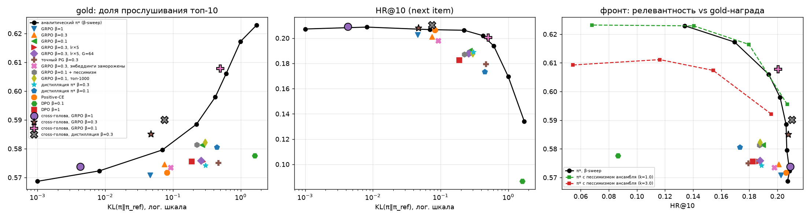

### 5.4 RL-обучение политики (GRPO): что получается на самом деле

Алгоритм описан в 3.5: 16 сэмплов на контекст, advantage = r − среднее по группе, точный KL ко всему
распределению π_ref. Базовые настройки: 1 500 шагов × 64 контекста, lr 1e-4. Кривые обучения (точки каждые 250
шагов на 2 000 контекстах валидации) лежат в `results/rl_*.json`.

*Чёрная линия — аналитический оптимум π* при разных β; маркеры — обученные политики. Слева: gold-награда против KL;
в центре: HR@10 против KL; справа: фронт «HR@10 – gold».*

**Основные прогоны** (валидация; база: HR@10 0,207, NDCG@10 по суткам 0,164, Recall@10 listen+ 0,149,
gold played 0,569):

| политика | KL | энтропия | HR@10 | NDCG@10 (24 ч) | Recall@10 listen+ | proxy played | gold played | длина, с | coverage | top-1 доля |
|---|---|---|---|---|---|---|---|---|---|---|
| GRPO played, β=1 | 0,05 | 6,92 | 0,203 | 0,162 | 0,148 | 0,631 | 0,571 | 192 | 0,37 | 0,07 |
| GRPO played, β=0,3 | 0,08 | 6,83 | 0,201 | 0,162 | 0,148 | 0,639 | 0,575 | 187 | 0,36 | 0,09 |
| GRPO played, β=0,1 | 0,27 | 6,52 | 0,190 | 0,156 | 0,142 | 0,652 | 0,581 | 179 | 0,32 | 0,15 |
| GRPO played, β=0 (без KL) | 12,1 | **0,006** | **0,008** | 0,008 | 0,010 | 0,674 | 0,608 | 127 | **0,007** | **1,00** |
| *π*, β=1 (для сравнения)* | *0,07* | — | *0,207* | *0,169* | *0,157* | *0,646* | *0,580* | *192* | *0,38* | *0,07* |
| *π*, β=0,5* | *0,22* | — | *0,206* | *0,173* | *0,161* | *0,662* | *0,589* | *189* | *0,38* | *0,08* |
| GRPO seconds, β=0,3 | 12,4 | 0,04 | 0,017 | 0,007 | 0,010 | 0,548 | 0,472 | **832** | 0,015 | **1,00** |
| GRPO seconds, β=0,3, топ-1000 | 2,75 | 3,84 | 0,139 | 0,099 | 0,092 | 0,588 | 0,510 | 362 | 0,20 | 0,22 |
| GRPO played, β=0, топ-1000 | 6,2 | 0,91 | 0,054 | 0,060 | 0,059 | 0,674 | 0,589 | 148 | 0,08 | 0,28 |
| GRPO full, β=0,3 | 0,08 | 6,81 | 0,200 | 0,162 | 0,147 | 0,639 | 0,575 | 187 | 0,36 | 0,09 |
| GRPO played_db, β=0,3 | 0,08 | 6,89 | 0,202 | 0,160 | 0,145 | 0,633 | 0,569 | 205 | 0,36 | 0,07 |
| GRPO like, β=0,3 | 0,37 | 6,48 | 0,190 | 0,149 | 0,134 | 0,613 | 0,553 | 212 | 0,32 | 0,11 |
| GRPO lt, β=0,3 | 0,18 | 7,19 | 0,186 | 0,151 | 0,137 | 0,620 | 0,562 | 198 | 0,33 | 0,10 |
| GRPO like+0,1·доля, β=0,3 | 0,18 | 6,64 | 0,196 | 0,157 | 0,142 | 0,627 | 0,564 | 201 | 0,34 | 0,09 |
| GRPO played, β=0,1, пессимизм k=1 | 0,23 | 6,56 | 0,187 | 0,155 | 0,141 | 0,649 | 0,581 | 178 | 0,32 | 0,13 |

**1. Максимизировать награду удаётся, но дорого.** Proxy и gold растут монотонно с уменьшением β, однако:
- Без KL (β=0) политика за 250 шагов схлопывается: для всех пользователей один и тот же 105-секундный трек
  (99,99 % списков), энтропия 7,06 → 0,006. Gold при этом даже выше (0,608), чем у любого разумного варианта.
  Судья хвалит «самый дослушиваемый трек вообще», но такой выдачей пользоваться нельзя: HR@10 0,008.
  Это главный ответ на вопрос «можно ли увеличить награду без потери точности» в варианте без регуляризации: нет.
- Награда без верхней границы (секунды) ломает политику **даже с KL**. GRPO сэмплирует из всего каталога, находит
  35-минутный трек (2 130 с, 511 прослушиваний в train) и отдаёт его всем. Аналитический оптимум по топ-1000
  этого не делал, потому что этот трек не попадает в кандидаты. Ограничение политики топ-1000 базовой модели
  («переранжирование внутри поддержки») снимает коллапс: длина 362 с вместо 832, HR@10 0,139 вместо 0,017.
  Награда при этом всё равно плохая.

**2. Обученная политика заметно хуже точного оптимума.** На фронте «KL – gold» и «HR – gold» все обученные политики
лежат ниже чёрной линии π*:
- GRPO β=0,3 при KL 0,08 даёт gold 0,575 и HR 0,201. π* при почти том же KL (β=1, KL 0,07) — gold 0,580 и HR 0,207.
- GRPO β=0,1 при KL 0,27 даёт gold 0,581 и HR 0,190. π* при KL 0,22 — gold 0,589 и HR 0,206.

Примерно вдвое меньше прироста gold на единицу KL (для точного градиента и DPO — в 4–6 раз). Хуже того, **на реальных данных** все RL-политики теряют
NDCG и Recall по суткам (например, Recall@10 listen+ 0,149 → 0,142–0,148). π* при том же KL их **повышает**
(0,157–0,161). То есть «бесплатный» участок из 5.2 RL-обучением не достигается.

**3. Почему так: диагностика.** Метрика — корреляция внутри контекста между изменением логитов политики
(log π − log π_ref) и нормированной наградой на топ-100 кандидатах. У π* она равна 1 по построению.

| вариант (β=0,3, если не указано) | что меняли | KL | gold played | корреляция с наградой: val / train-контексты | std изменения логитов |
|---|---|---|---|---|---|
| GRPO, lr 1e-4, 1 500 шагов | — | 0,08 | 0,575 | 0,35 / 0,32 | 0,38 |
| GRPO β=0,1 | слабее KL | 0,27 | 0,581 | 0,44 / 0,41 | 0,65 |
| GRPO, lr 5e-4, 6 000 шагов | больше шагов и lr | 0,28 | 0,576 | 0,28 / 0,26 | 0,78 |
| то же, G=64 | в 4 раза больше сэмплов | 0,26 | 0,576 | 0,29 / 0,28 | 0,74 |
| точный градиент по топ-1000 | **нет шума сэмплирования** | 0,47 | 0,575 | 0,22 / 0,20 | 0,86 |
| GRPO, эмбеддинги заморожены | выходной слой не двигается | 0,09 | 0,573 | 0,20 / 0,20 | 0,42 |
| Positive-CE | без RM | 0,08 | 0,572 | 0,09 | 0,39 |
| DPO β=1 | без RM | 0,19 | 0,576 | 0,14 | 0,60 |
| DPO β=0,1 | без RM | 1,62 | 0,578 | 0,15 | 1,62 |
| **дистилляция π***, lr 5e-4 | обучение с учителем на точный оптимум | 0,31 | 0,574 | 0,22 / — | 0,67 |
| **дистилляция π***, lr 1e-4 | то же, медленнее | 0,12 | 0,574 | 0,30 / — | 0,41 |

Выводы из таблицы:
- **Не шум сэмплирования.** Учетверение группы ничего не меняет, а точный градиент по 1 000 кандидатам без
  сэмплирования даже хуже: он тратит больше всего KL при той же награде.
- **Не переобучение.** На обучающих контекстах согласованность та же, что на валидации (0,32 против 0,35).
- **Не связанный выходной слой.** Заморозка эмбеддингов уменьшает дрейф, но и согласованность падает.
- Остаётся **сама постановка обучения**. Награда, которую надо «вшить» в политику, — это внутриконтекстная поправка
  с малой амплитудой (≈4 % дисперсии RM, см. 4.2). Она зависит от тонких признаков «пользователь × трек»:
  сколько раз слушал, как дослушивал, тот же ли артист. Policy gradient приносит слабый сигнал, а Adam
  нормирует шаги, поэтому каждый шаг двигает параметры на фиксированную величину. Сигнал усиливается вместе с шумом,
  и большая часть «потраченного» KL уходит в изменения, не связанные с наградой. Чем больше lr и шагов, тем больше
  KL и тем ниже согласованность.
- Политика «помнит» и глобальную часть: доля изменения, объяснимая константой на трек, 0,2–0,5, и выдача немного
  сжимается (top-1 доля растёт с 0,06 до 0,09–0,15).

**4. Может ли сеть вообще выразить π\*?** Самая прямая проверка — убрать RL совсем и учить политику с учителем:
кросс-энтропия к точному оптимуму π* = π_ref·exp(r/β)/Z для каждого обучающего контекста (`--pg distill`).
Результат тот же. При lr 5e-4 KL растёт до 0,31 (у целевого π* — 0,42), но gold почти не меняется (0,574), а
согласованность с наградой 0,22. При lr 1e-4 KL 0,12, gold 0,574 при HR@10 0,200 на валидации, согласованность 0,30. На тесте дистилляция,
как и GRPO, значимо теряет HR@10 (0,193 → 0,177–0,185). Узкое место — не сигнал RL, а то, что политика не может
представить нужную поправку.

**5. Выразимость (softmax bottleneck).** Выход GPT-2 — `logit(a|s) = ⟨h_s, e_a⟩`; эмбеддинги треков общие для
всех контекстов. Проверим, насколько поправку r(s,·), которую требует π*, можно записать как ⟨w_s, e_a⟩ + b_s при
неизменных e_a. Для 300 контекстов валидации подбирали w_s гребневой регрессией на случайной половине топ-1000
кандидатов и считали R² на другой половине (`src/bottleneck.py`):

| что приближаем через ⟨w_s, e_a⟩ | отложенный R² |
|---|---|
| собственные лог-вероятности базовой модели | **0,60** |
| нормированная награда RM (то, что нужно добавить для π*) | **0,12** |
| та же награда, перемешанная внутри контекста (уровень случайности) | ≤ 0 |

Распределение базовой модели «живёт» в пространстве эмбеддингов треков, а награда — почти нет. Награда
определяется признаками «пользователь × трек»: сколько раз слушал этот трек, как его дослушивал, как давно,
дослушивает ли этого артиста. Через один вектор контекста их не передать. Чтобы всё же сдвинуть
распределение в нужную сторону, обучение двигает эмбеддинги, общие для всех пользователей. Отсюда глобальные
побочные эффекты (выдача сжимается, top-1 доля растёт) и KL, потраченный не на награду. У аналитического π*
этой проблемы нет: он применяет поправку RM напрямую, а RM считает эти признаки явно. Вывод для практики:
если награда опирается на признаки, которых нет в представлении политики, её надо применять на этапе
ранжирования (реранкинг), а не пытаться «вшить» в генератор через RL. Альтернатива — дать политике такие
признаки. Это мы проверили экспериментом в 5.4.1: с ними тот же GRPO работает.

**6. Многошаговое GRPO** (5 треков подряд, награда за последовательность, раздел 3.5) по одношаговым метрикам
не отличается от одношагового при том же β: HR@10 0,194–0,196, gold 0,573–0,574, KL 0,08–0,09. Бонус за
разнообразие артистов немного увеличивает число артистов в списке (7,60 → 7,68) и снижает top-1 долю
(0,066 → 0,059). Как многошаговое обучение меняет поведение при генерации вперёд — в 5.7.

**7. Пессимизм в RL** (ансамбль из трёх RM, награда = среднее − std) при β=0,1 дал почти то же, что обычный GRPO:
gold 0,581 и 0,581, HR 0,187 и 0,190, KL 0,23 и 0,27. Разброс ансамбля слишком мал и не там, где ошибка.
